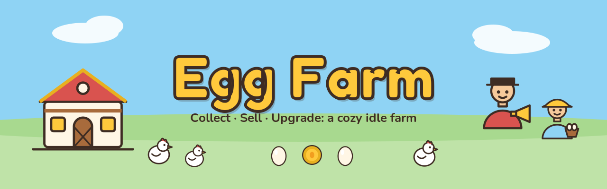
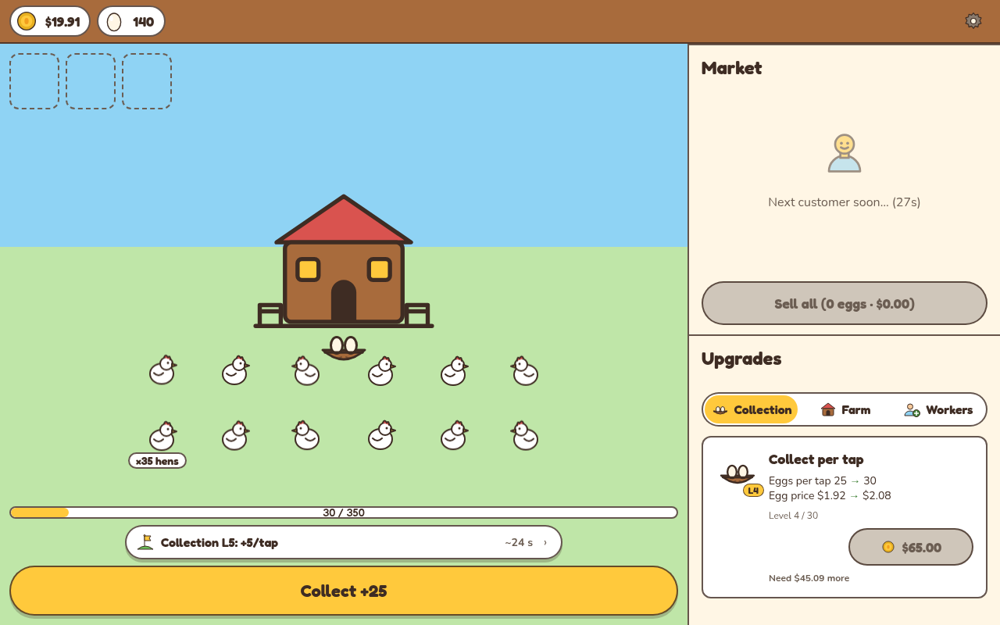
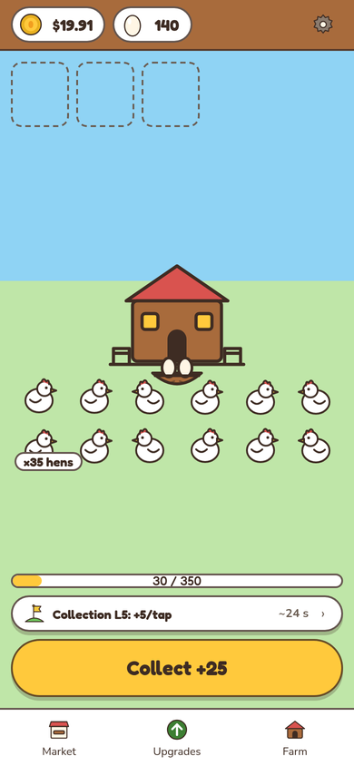
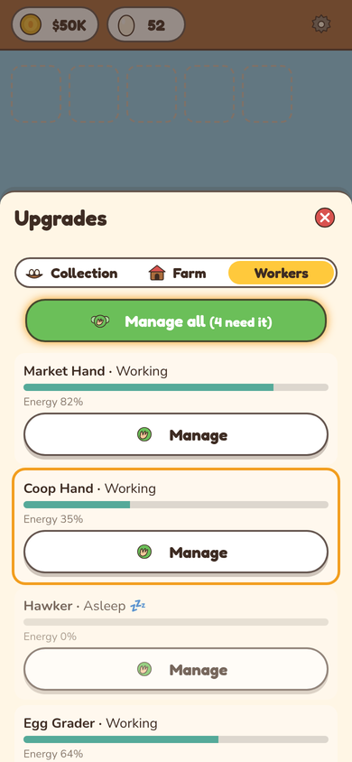

# Egg Farm

An idle egg-farm management game for the web, written in TypeScript and built with Vite. Your hens lay eggs on their own. You collect them, sell them to customers who queue at your farm, spend the coins on upgrades, and later hire helpers who do some of the work for you, as long as you keep them rested and paid.

This branch (`main`) is the **M2 "Workers"** build: `m2-rc1` plus post-rc1 polish (`dd15dbf`).

| Desktop | Farm (phone) | Workers (phone) |
|---|---|---|
|  |  |  |

## Requirements

- [Node.js](https://nodejs.org/) **20 or newer** (includes npm)
- git

## Play locally

All commands run from the repo root.

```bash
git clone https://github.com/PrincipalLewis/egg-farm.git
cd egg-farm
npm ci
npm run dev
```

Open the URL Vite prints (usually http://localhost:5173).

## Play on your phone (same Wi-Fi)

```bash
npm run dev -- --host
```

Vite prints a `Network:` address such as `http://192.168.1.20:5173`. Open it in your phone's browser while the phone is on the same Wi-Fi as your computer. Your computer's firewall must allow the port.

## Production build

```bash
npm run build      # checks balance.json vs data/economy.csv, type-checks, builds to dist/
npm run preview    # serves the built game from dist/ (the URL is printed)
```

## Single-file version (no install)

The [`m2-rc1-play` release](https://github.com/PrincipalLewis/egg-farm/releases/tag/m2-rc1-play) has `egg-farm-dd15dbf.html`, the whole game in one file. Download it and open it in a browser (on iPhone, open it in Safari rather than the Files preview). Progress is saved in that browser's local storage.

## How to play

### The core loop: collect → sell → upgrade
- **Collect:** hens fill the Coop automatically. Tap **Collect** to move eggs into your Basket. When the Coop reaches its limit it shows **Full!** and stops filling, so come back and tap.
- **Sell:** customers arrive and each one wants a set number of eggs. Tap a customer to open the Market, then tap **Sell** for that customer or **Sell all** for the whole queue. Customers who wait too long (30 s) walk off.
- **Upgrade Collection:** each level gives +5 eggs per tap and +12% egg price.
- **Upgrade Farm:** each level gives +5 hens, a bigger Coop (+50), a higher base egg price (+$0.05), and customers who come more often and buy more. The coop changes look at Farm L5, L10 and L20.
- **Away time:** if you're gone 60 s or longer, a welcome-back screen gives you eggs equal to 25% of your production, counting up to 2 h away.

### What to try first (about the first 10 minutes)
1. Tap **Collect** a few times. Hens lay about 1 egg per second at the start.
2. Your first customer shows up at about 10 s. Tap them and **Sell**.
3. Buy your first **Collection** upgrade ($10). You should get it within about 30 s.
4. Save up $100 for **Farm L1**. Farm levels are the main way to grow.
5. Keep collecting, use **Sell all** every so often, and buy Farm whenever you can afford it. Buy Collection when it's cheap compared to the next Farm level.
6. At **Farm L3**, open the **Workers** tab and hire a **Market Hand** ($40).
7. If you keep a steady pace, you'll reach about Farm L10 at the 10-minute mark.

### Workers (M2)
- **Hiring:** helpers unlock as your Farm grows. The **Market Hand** (Farm L3) serves customers for you. The **Coop Hand** (Farm L7) collects eggs for you. The **Hawker** (Farm L8) makes customers buy more. The **Egg Grader** (Farm L18 and up, sold in grades) makes eggs sell for more. A hire is permanent: you can't fire a helper and you don't get a refund.
- **Energy and Tired:** helpers slowly lose energy, going from full to empty in about 15 minutes. At 40% they start to yawn. Below 30% they're **Tired** and work slower. At 0% they're **Asleep** and stop working.
- **Manage and Manage all:** tap **Manage** to refill a helper to 100%. It's free. Once you have 3 or more helpers, **Manage all** refills everyone at once. Both share a 30 s cooldown.
- **Wages and Unpaid:** the Market Hand and Coop Hand earn a small wage per minute that goes up with your Farm level. If you can't pay, the helper goes **Unpaid** and stops working. It starts again on its own once you have enough coins. You never go into debt, and a helper never leaves you worse off than having no helper at all. Sleeping helpers aren't paid.

### Planned for M3 (not in this build)
- **Onboarding:** a short guided intro (collect → sell → upgrade) that you can skip, plus a quick intro to Workers.
- **Next-goal hint:** a strip above Collect that shows the next thing worth buying.
- **Settings > Export log:** saves your play log as a file, and also works on iPhone Safari.
- **Save recovery:** if a save gets damaged, the game restores a backup when it can and always tells you what happened.
- **Mobile portrait and desktop polish**, with touch targets of at least 44 px.
- **Accessibility:** better contrast, keyboard focus, and reduced-motion support.

### Tips
- Your progress is stored in this browser only (local storage). Clearing site data or using a private window means a fresh farm, and a different browser or device starts its own farm.
- If the Coop says **Full!**, your eggs are going to waste. Collect, or hire a Coop Hand.

## Known issues (this build)

| ID | What you might notice | Status | Fix planned in |
|---|---|---|---|
| PT1-3 | **The game gets stuck on "Tap to start."** You tap the button, it greys out, and nothing else happens. No error message appears. It happens when the browser can't start sound, for example on a computer with no speakers or headphones. We've seen it in Firefox. | Open (major) | M3 playtest build |
| AC14b | **If your save file gets damaged, the game quietly starts over from the beginning.** There's no message and no backup yet. This is rare, but if your progress suddenly disappears, that's probably why. | Open, expected | M3 rc0 (Thu Oct 22), which adds a backup save and a notice |
| — | **Not yet tested on a real iPhone or a real Android phone.** We've only tried phone-sized screens on a computer. Real phones may behave differently, especially sound, rotating the phone, and switching apps. | Not started | needs devices |

**If you're stuck on "Tap to start" (PT1-3):**
1. **Open the game in a different browser (Chrome works).** This is the workaround we've confirmed.
2. Make sure your computer has a working sound output (speakers or headphones plugged in and turned on), then reload the page. We think this helps, but we haven't confirmed it yet.
3. Reloading on its own usually doesn't help in the same browser.

### Supported browsers right now

| Browser | Status |
|---|---|
| **Google Chrome** (computer) | Supported. This is our main test browser. |
| **Microsoft Edge** (computer) | Untested. Built on the same engine as Chrome, so it should work. |
| **Safari** (Mac) | Untested on a real Mac. We test with Safari's engine (WebKit) only. |
| **Firefox** (computer) | Works once started, but it can get stuck on "Tap to start" (PT1-3). If that happens, use Chrome. |
| **iPhone / Android phones** | Untested on real phones. Phone-sized screens work in testing on a computer. |

The game is designed for a phone held upright (about 390 px wide) and for desktop windows. Sideways (landscape) on a phone is not supported yet.

## How to report a bug

Open a new issue in this repo's **Issues** tab and label it:

| Label | Use it when |
|---|---|
| `bug` + `blocker` | You can't play at all, or you lost progress (for example, the game won't start or your save is gone). |
| `bug` + `major` | An important part is broken but you can keep playing (for example, a button does nothing or numbers look wrong). |
| `bug` + `minor` | Something looks odd or is a little annoying (for example, a typo, overlapping text or a small visual glitch). |

Not sure which one? Just use `bug` and we'll sort it.

Copy this into the issue:

```
**What happened:**
**What I expected:**
**Steps to make it happen again:**
1.
2.
3.
**Browser and version:** (e.g. Chrome 154, Safari 18)
**Device:** (e.g. MacBook Air, iPhone 15, Windows laptop)
**When:** date and time, with time zone
**Build:** shown at the bottom of Settings
**Screenshot or screen recording:** (drag it in here)
```

(Settings > Export log arrives in M3; until then a screenshot and clear steps are the best help.)

## For developers

- Game balance lives in `data/economy.csv`; `src/config/balance.json` is generated from it with `npm run sync-economy`.
- Add `?debug=1` to the URL for the debug panel.
- `npm test` runs the unit and pacing tests.
