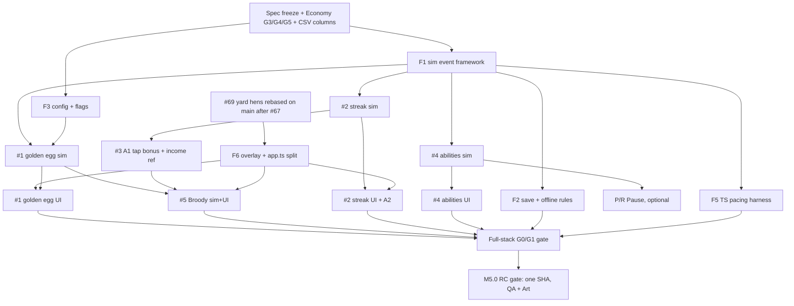

# M5.0 "Make the active layer real": engineering sizing (on paper)
**v1.2 · 2026-10-24 (v1.0 16:05; v1.1 adds §9 worker specs; v1.2 16:50 adds §12 Collection specs, §13 HoQA answers, §14 Sales-stopped, §15 totals) · Head of Engineering · under D-CEO-20261024-06 (decisions.md:25).** No code, branches or PRs. The build hold stands until Vadim's go (D-CEO-20261024-04).
**Code reference:** `/workspace/wt-m41-rc1` = rc/m4.1-rc1 @ `5d9efa6` (read-only). **Inputs read:** `product/m5-interaction-plan.md` v0.1 §1/§4/§5/§6; golden egg spec v0.5; streak spec v0.3; `workers/m4-abilities-spec.md` v0.3; `workers/m5-worker-abilities-spec.md` v0.1 DRAFT (landed 16:03); `research/v2-slices/{collection,workers}.md`; `art-ux/m4-timed-collectible.md` v1.0 + `art-ux/mocks/m4-spawn-*.png`; `product/m4-manage-proposal.md` §2.6 (Pause); `qa/decisions.md:259`.
**Units:** dd = engineer dev-days (code + unit/sim tests + CCR fixes), engineering only. QA and Art passes are listed separately. **[A]** = an assumption.

## 0. Headline
| | |
|---|---|
| **Engineering total, M5.0** | **≈29.5–37 dd** (v1.2, §15): scope items 1–4 plus the Sales-stopped chip (§14), the M5.0 telemetry subset, the abilities sheet auto-close and the §12/§13 additions. v1.1 was 26.75–33.5. **Full telemetry v0.6.2 is separate:** 6–7.5 dd, M5.0.1 (§10.2, D-CEO-07) |
| **+ Pause/Resume (item 5)** | **+2.5–3.0 dd** (v1.2), so **≈32–40 dd** with it |
| **Calendar, code complete → RC gate passed** | **≈13–15 working days with 4 engineers** (v1.2; seat 95daf662 re-activated, D-CEO-07). [A] 1 dd per engineer per working day; plus 1–2 days of spec freeze and Economy G3 before day 1 |
| **Critical path** | spec freeze + Economy G3 → F1 sim event framework → #1 golden egg sim → #1 golden egg UI (needs F6) → #5 Broody Hen → full-stack pacing gate (F5) → RC gate |
| **HoP estimate vs this** | HoP's ≈11–13 dd covers feature code only. It leaves out the shared framework, the save/offline rules, the TS pacing harness, the app.ts split and RC work, which none of the plan's items carry, plus fuller UI sizes from the Art specs. The feature lines alone come to 12.75–15 dd, close to HoP's. |
| **Pause/Resume verdict** | **IN** (CEO D-CEO-20261024-06; D-HOP-04 #9, D-HOP-06). It's the last PR, behind its own flag, and the first thing cut. 3.0–3.5 dd (§15b: 2.5–3.0 + 0.5 G5-P driver; incl. +0.25 P-12 golden), off the critical path. Spec v1.0.1 was reviewed in §9 (B5, B6, B1/B3); **v1.2+ confirmed BUILDABLE (§11)**; 3.0–3.5 dd per §15b |
| **Buildable?** | Worker specs v1.2: yes (§11). Collection specs v1.1: **yes**, with HoE decisions D-C1–D-C5 as text fixes (§12). Sales-stopped v1.1: **yes** (§14). Merges are gated on Art assets (golden egg, broody nest, all new SFX) and the Economy G3 CSV PR |

## 1. Cross-cutting foundations (build first)
What exists today: a pure 10 Hz fixed-step sim (`sim/tick.ts` `step()`/`advance()`), one xorshift32 stream `state.rng` (`sim/state.ts:48`) that drives customer arrivals and demand, and one sale-multiplier hook `saleMultipliers()` (`sim/payout.ts:8-10`; today Grader only). Every price preview and credit goes through it (`ui/app.ts:576,582`), so frenzy and streak in one place cover both. `SimEvent` is a closed union (`sim/events.ts`). Saves are v6 with optional fields and no bump (`save/save.ts:6`; the tracksV7 precedent). Hidden periods are settled in `game.ts` `settleHiddenPeriod()`: under 60 s the sim keeps running, at 60 s or more it pays an offline grant. Feature flags: only `balance.m4.enabled` (`config/formulas.ts:137`). `sync-economy.ts:161` already turns any `tc_*` CSV column into `balance.m4.tc`. Goldens pin the save bytes and the sim trace (`engineering/golden/m4on-golden.90a9c84.test.ts`, `a54c9cf9`; flag-off `f90d1678`). There is **no** spawn, collectible, timer, ability, attended or rolling-income code (`qa/decisions.md:259`, confirmed).

| ID | Foundation | What it touches | dd | Conf. |
|---|---|---|---|---|
| **F1** | **Deterministic sim event framework.** (a) A **second RNG stream** `evRng`, seeded from `mixSeed(seed ^ K)`. Spawns and rolls must **never** draw from `state.rng`, or every customer sequence, pacing seed and golden moves. (b) An **attended clock**: `step()` takes an `attended` input (tab visible, no modal or sheet open) that advances spawn and lifetime timers only. Wall-clock timers (frenzy end, ability `readyAt`) are stored as absolute ms and checked against an injected `now`. (c) A timed-effects registry that feeds `saleMultipliers()` (streak, frenzy, Rush, Shout, Inspect) and `prodEggsPerSec()` (Sweep), with a `by` (player/market_hand) attribution for Rush. (d) New `SimEvent` members. (e) All new `GameState` fields declared once, optional and absent while the flags are off. | `sim/state.ts`, `sim/tick.ts`, `sim/payout.ts`, `sim/tracks.ts`, `sim/events.ts`, `game.ts` (frame / hidden sim passes `attended`) | **3–3.5** | M |
| **F2** | **Save + offline/clock rules.** Optional fields (`tc`, `streakBest`, `abilities.{id}.readyAt`, `broodyNestCents`, `broodyHenIdx`, `frenzyEndAt`, `nextSpawnRemainingS`). **Recommend no SAVE_VERSION bump** (R12, slice E7 and m5 abilities spec §6 all say so; same pattern as tracksV7). A bump to v7 would cost +1 dd and would collide with the existing `migrate-v7.ts` naming and the newer-build read-only path. Work: validation and sanitising of the new numerics (non-finite or negative → default, like `NUM_FIELDS` at `save.ts:201`); `readyAt` clamped to [now, now+cd] (clock tamper); a negative delta counts as 0. In `settleHiddenPeriod`, the 60 s-or-more path removes an on-screen egg (`collectible_expired reason=offline`), ends abilities, sets the streak to 0, keeps the nest without accrual, and restarts the spawn gap after the welcome-back modal closes. The under-60 s path applies the streak's grace/decay in one step. Downgrade check: an M4.1 build loading an M5 save must ignore the unknown fields (verify; serialize writes the whole state). | `save/save.ts`, `save/hidden-time.ts`, `game.ts`, `sim/offline.ts` (untouched by design), save fixtures | **1.5–2** | M |
| **F3** | **Config wiring, no magic numbers.** New CSV columns from Economy (§8 G2), then `sync-economy --check`. Per-item flags `m4.tc.*_enabled`, kept like `m4.enabled` (sync keeps only the flag). `validateBalance` rules: weights sum to 1, gap_min ≤ gap_max, warn < urgent < despawn, cap > 0. Plus a test that greps `src/` for literal tunables. | `scripts/sync-economy.ts`, `config/balance.ts`, `data/economy.csv` (copied from product) | **0.5–1** | H |
| **F4** | **Telemetry plumbing.** New event names, the `isPinned` list, `session_end` extensions (`golden_cents`, `tap_bonus_cents`, `broody_cents`, `credited_taps`), and the `tap` batch's `credited`/`bonus_cents`. Per-item events are counted inside each item. | `telemetry/telemetry.ts`, `game.ts` `emit()` | **0.5** | H |
| **F5** | **TS active-player pacing harness.** There are no active bots today (`tests/bot*.ts`, 166 lines, are buy/idle bots). Add optimal, seller15 and casual (0.5 tap/s, 60% catch) bots that tap, catch eggs, pop the nest and fire calls. G0 never-tap stays byte-identical (AC7, AC-SC9 L0–9 trace on/off). G1: P95 ≤ 2.0 and worst seed ≤ 2.25 over every 10-minute window, seeds 0–99, F10/F18/F24. Slow suite in CI. This is the build-side mirror of Economy's Python gate; it doesn't replace it. | `tests/bot-m5.ts`, `tests/*.slow.test.ts`, `vitest.slow.config.ts` | **2–3** | M-L |
| **F6** | **UI layer + app.ts split.** `ui/app.ts` is one 717-line `mountApp` closure with `render()` at :528. That is the conflict hotspot, and #69 (yard hens, :528-536) also edits it. Extract a `ui/overlay.ts` tap-target layer: 8 spawn slots per layout from Art v1.0 §2, checked against live rects, plus exclusion zones (streak meter +16 px, broody hen, Collect). Add the `attended` signal (modal/sheet/explainer open, `dialogOpen()`), the audio hook registry and the reduced-motion switch. No behaviour change (proved by rc0 Chromium snapshots). | `ui/app.ts`, new `ui/overlay.ts`, `ui/audio.ts`, `platform/visibility.ts` (read-only) | **1.5–2** | M |
| | **Foundations subtotal** | | **9–12** | |

## 2. Per item
| # | Item | Code it touches (real files) | New systems | Eng dd | Conf. | QA pass (QA days) | Art pass |
|---|---|---|---|---|---|---|---|
| **1** | **Golden egg** v0.5 + Art v1.0, gap U[120,300] s after resolve, first spawn 45 s after F8, 30 s life | `sim/tick.ts` (spawn timer on the attended clock), `sim/payout.ts` (frenzy ×2 on all sales), `sim/actions.ts` (new `tapCollectible` action, roll at tap from `evRng`), `game.ts`, `ui/overlay.ts`, `ui/app.ts` (price chips at :576/582), `ui/order-list.ts`/`orders.ts` (2× chip), `ui/audio.ts` | Spawn/lifetime state machine (idle/warn 20/urgent 27/fade 30), reward roll + `eggs_cash` from F20, frenzy pill, popups, the inert boost-exclusion rule, 3 SFX hooks, freeze under scrim | **sim 1.5 + UI 2–2.5 + tel 0.25 = 3.75–4.25** | M | 1.5 (M4-AC5/15/22/23/24/27 → test plan; 360/375/1280) | Asset name check (spec `fx-golden-egg.svg` vs shipped `golden-egg.svg`), states review, live-build UI review 0.5 |
| **2** | **Streak + A2 combos** (cap from CSV; 0.40 today vs 0.28 provisional, R9) | `sim/actions.ts` `collect` (:55), `sim/payout.ts`, `sim/tick.ts` (grace 3 s, decay 0.03/s), `game.ts` (hidden step), `ui/app.ts` meter under Collect, price chips + 360 collapse | Credited-tap gate (1 per s), decay, `streak_peak` lifecycle, meter states, cap chime + 10 % pitch, A2 tier pops | **sim 1 + UI 1.25–1.5 + A2 0.5 = 2.75–3** | M-H | 1 (S-AC1–24) | Meter/chip review, A2 pop motion 0.5 |
| **3** | **A1 coin-paying tap** (`tap_income_share` 0.03 × 60 s reference income) | `sim/actions.ts` collect, new `sim/income-ref.ts`, `ui/fx.ts` (+$ pop), `telemetry` | **Rolling 60 s reference income** in the sim (attended seconds only; excludes streak, frenzy and boost; shared with #5). `econ/income.ts` is steady-state, not rolling, so it can't be reused | **1–1.5** | M | 0.5 | +$ pop review 0.25 |
| **4** | **Worker abilities + Activate-all**, unlock F10, free in M5.0 | `sim/workers.ts` (eligibility, early end on asleep/unpaid), `sim/tick.ts`, `sim/payout.ts` (Rush on market_hand sales, Shout, Inspect +0.5 on tier mult before the mood share), `sim/tracks.ts` `prodEggsPerSec` (Sweep ×1.15), `econ/income.ts`, `ui/workers-ui.ts` (M2 placeholder rows; **no rc2 Shift sheet exists**), `ui/app.ts` (badge on tab/nav) | `abilities` state with wall-clock `readyAt`, effect windows, Activate-all, "⚡N" badge on **attended**: `leave_attended_window_s` is in the CSV (col 123) but **no attended tracker exists in `src/`**, so it's new | **sim 1.75–2 + UI 1–1.5 + tel 0.25 = 3–3.75** | M | 1.5 (AC-M5A-1..6, AC-SC9 trace) | Call buttons + Activate-all next to Manage all at 360 (AC-M5A-6), 0.5 |
| **5** | **Broody Hen + B2 flutter** on the #1 framework | `ui/app.ts` yard sprites (the `min(hensN,12)` code from #69: **#69 must merge first**), `ui/overlay.ts`, `sim/tick.ts` (nest accrual on the attended clock), `sim/income-ref.ts`, `sim/actions.ts` (`tapBroody`), save fields | Nest accrual/cap/ready, hen choice from `evRng` (must be a drawn sprite), glow, persistence on reload | **sim 0.75 + UI 1.25–1.5 + tel 0.25 = 2.25–2.5** | **L-M** (no spec yet) | 1 | **Glow/wobble assets not delivered** (only the egg assets exist), 0.5–1 |
| | **Features subtotal (scope items 1–4 = plan #1–#5)** | | | **12.75–15** | | **5.5** | **≈2.5–3** |
| **P/R** | **Pause/Resume** (optional, scope item 5) | `sim/workers.ts` (`mood()` gets `paused`; `isOff`, `graderMult`, `hawkerDemandMult`, `needManage`), `sim/tick.ts` (energy recovery, no wage, frozen action timers, skip in the Unpaid-resume order), `econ/income.ts`, `ui/rates.ts`, `ui/workers-ui.ts` (44 px toggle, 2 s debounce, "All workers paused" banner), abilities eligibility | A 5th worker state through every worker code path | **sim 1.25–1.5 + UI 0.75–1 = 2–2.5** | M | 1 | Toggle + banner 0.25 |
| | **Integration / RC**: flag-on golden (new pin), CCR fix rounds, 14-PR merge order, RC build checks | goldens, `tests/` | | **2.5–3.5** | | **RC gate ≈2** (Saves QA + UI QA, one SHA) | Final live-build review 0.5 |

**QA total ≈ 9.5 QA-days (≈10.5 with Pause). Art ≈ 3.5–4.5 days, plus the broody assets.** Economy (not engineering) owns G3–G5 before build, then a final full-stack run on the RC SHA.

## 3. Dependency graph and build order

**Order:** F1 + F3 + F6 (in parallel) → F2 → #1 sim → #2 sim → #3 → #4 sim → #1 UI → #2 UI → #4 UI → #5 → (P/R) → F5 full-stack gate → RC.

## 4. Staffing (parallel) and merge hotspots
| Engineer | Owns | dd | Working days |
|---|---|---|---|
| **Senior Software Architect** | F1, F3, #1 sim, #3 income-ref, #5 sim, integration/RC lead | ≈10–11 | d1–d12 |
| **Saves & Persistence** | F2, the hidden/offline wiring for every item, save fixtures/goldens, #2 streak sim, **M5.0 telemetry subset (§10.1, d3–d5)**, (P/R Pause sim) | ≈8–9.5 (v1.1) | d2–d11 |
| **UI & rc1 Fixes** | #69 rebase first, F6, #2 UI + A2, #1 UI, #3 pop, #5 UI | ≈9–10.5 | d1–d12 (**the busiest seat**) |
| **Features & Economy Wiring: re-activate** (stopped) | F5 harness, #4 abilities sim + UI incl. the m2 card (§9.4), (P/R Pause UI) | ≈7–8.75 (v1.1) | d2–d11; then full telemetry migration as M5.0.1 (§10.2) |

- **With 3 engineers:** F5 and #4 fall to the Architect and Saves, and the calendar grows to ≈16–19 days. **Recommendation:** re-activate Features & Economy Wiring (an existing CEO-approved seat, roster:30) for M5.0. No new hire is needed. A hire only pays off if M5.1 (≈17–23 dd HoP est., Art-heavy) starts right behind.
- **Hotspots:**
  1. `ui/app.ts`: render() :528+, price lines :576/582, yard :528-536. Mitigation: F6 lands first, then each feature mounts its own module (`ui/golden-egg.ts`, `ui/streak-meter.ts`, `ui/broody.ts`, `ui/abilities-ui.ts`) through one registration line.
  2. `sim/payout.ts` `saleMultipliers()`, where 5 effects land. Mitigation: F1 defines the registry and each item adds one entry.
  3. `sim/state.ts` `GameState`. Mitigation: all fields are declared in F1.
  4. `sim/tick.ts` `step()`. Mitigation: one `stepTimers()` sub-call per system.
  5. `sim/workers.ts`, shared by #4 and P/R. Mitigation: one owner, P/R after #4.
  6. `data/economy.csv`/`balance.json`. Mitigation: **one** Economy CSV PR carries every new column.
  7. Goldens. Mitigation: flags off means the existing pins hold byte-identical. Add one new M5-on golden at the end.
- **PR split:** ≈14 PRs, each ≤ ~400 lines, each behind its item flag (default 0), merged in §3 order: F1a types/fields, F1b clock+rng, F1c multiplier registry, F2, F3, F6, then one sim PR and one UI PR per item, then F5, then (P/R). Same CI-diet and CCR flow as #68.

## 5. Pause/Resume verdict
- **Verdict: FITS. Conditional IN** as the last PR, behind its own flag, cut first if the calendar slips.
- **Cost:** 2–2.5 dd eng + 1 QA day + 0.25 Art. It's off the critical path, so it adds 0 calendar days with 4 engineers and ≈1 day with 3.
- **Conditions:**
  1. The CEO settles CEO "in if it fits" vs HoP R13 "Drop (economy knob, known exploit)". Economy's M4 check (`m4-manage-proposal.md:95`) found **no exploit** (pause/never 1.000 optimal), but that was before T3, so it needs a G5 re-run.
  2. One reconciled spec (`m5-worker-pause-spec.md`, referenced but not yet landed). The existing specs conflict: recovery is 0.5× drain in `m4-manage-proposal` §2.6 but 0.25× in rc2 Rest, and the Grader's paused bonus is "no output" vs 0%.
  3. Spec it as rc2 Rest's base, so M5.1's Refill/Rest doesn't rebuild it.
- **What it interacts with:**
  - Abilities: they are blocked "Paused" and end early on pause (m5 abilities §2.4/2.6), and the cooldown keeps running.
  - Fatigue/energy: recovery replaces drain, and there's no wage, which changes the Unpaid-resume reserve in `tick.ts`.
  - Manage all / `needManage`: whether paused workers count.
  - `income.ts`/`rates.ts` income and wage previews (rc1-asleep spec: "paused workers are left out").
  - The coop-full hint's `paused` variant (rc1-b1 spec).
  - The M4.2 fatigue chip.

## 6. Risks (ranked)
1. **Pacing gate G1 (P95 ≤ 2.0, worst seed ≤ 2.25).** The last full M4 stack measured a worst seed of 1.93–1.95 at F18. That was **before T3** and before A1 and Broody. The Economy v2 slice and the G3 run don't exist yet. If G3 fails late, the work turns into retunes and possibly cuts (plan option C: drop #4). *Mitigation:* no build before G3; every number in the CSV; a flag per item; the F5 harness in CI so drift shows on every PR.
2. **Tap-income share vs idle, and Python↔TS parity.** A1 "pays even with an empty coop" while the streak credits only taps that "move ≥ 1 egg". The reference income can feed back on itself (does it include golden cash, abilities or broody?). The attended-clock rules are UI-dependent and hard to mirror in Python. G0 (never-tap, AC7) must stay byte-identical, and abilities at F10 move L10–11 (R7). *Mitigation:* one written definition of "credited tap" and "reference income" before build; the L0–9 on/off trace test (AC-SC9).
3. **Determinism of the RNG spawns.**
   - `Game` seeds from `now()`, and there is one `rng` stream for customers. Any shared draw shifts every seed and both goldens.
   - Spawn time depends on attended time, which is UI input, and the roll happens at tap time.
   - *Mitigation:* a separate `evRng`, an injected attended schedule and `now` in sim tests, and pinned M5-on goldens.
4. **Save compatibility.** Optional fields with no bump, a downgrade M5→M4.1 (unknown fields), wall-clock `readyAt`/`frenzyEndAt` under clock tamper, and three stores (LS, .bak, IDB mirror). *Mitigation:* F2 sanitising, fixtures for old→new→old, and a Saves QA pass.
5. **app.ts conflicts and 360 px tap density.** Golden egg, broody hen, streak meter, Collect and the badge all sit in the scene. Art v1.0 covers the egg only. *Mitigation:* F6 first, Art's density review before the #5 UI.
6. **Perf (low).** The sim adds O(1) per tick at 10 Hz. The DOM cost is the price chips on every customer card, sprite animation and the ring SVG. *Mitigation:* `debug/frame-sampler.ts` budget in rc0 Chromium; chips update only on change.
7. **Open spec questions (§8).** Each one that's still open at kickoff is a stall on the critical path.

## 7. Calendar
- **4 engineers:** ≈12–14 working days from Vadim's go to M5.0 RC passed. The critical path is about 12 days: F1 3 → #1 sim 1.5 → #1 UI 2.5 → #5 2.5 → full-stack gate 1 → RC 2, with F6 and #69 running parallel in days 1–2.
- **3 engineers:** ≈17–20.5 working days (v1.1; was ≈16–19).
- Before day 1, add 1–2 days of spec freeze and Economy G3/G4/G5 (outside engineering).
- [A] No other work competes, #67/#68/#69 have merged, and CI minutes are available (post-#68 diet).

## 8. Spec gaps blocking a "buildable" confirmation
1. **Economy G3/G4/G5 not run** (plan §7.1 is a placeholder). No T3 re-sim of the golden egg, streak or abilities.
2. **CSV columns missing.** `tc_first_spawn_s` (45), `tc_warn_at_s` (20), `tc_urgent_at_s` (27), `tap_income_share`, `tap_bonus_income_window_s`, `broody_income_share`/`_cap_s`/`_ready_share`/`_unlock`, `tc_ability_unlock_farm` (10), and the A2 tier step. The `streak_cap` value is unresolved: CSV 0.40 vs R9 0.28 vs CEO 0.30.
3. **Golden egg v0.5 is still DRAFT** (HoP signs at kickoff, R14).
   - M4-AC24 still names focus and the M4-B boost. Restate it against G1.
   - Confirm the Art v1.0 spawn spots are final. They exist in `art-ux/m4-timed-collectible.md` §2 + mocks, although plan §1 lists them as missing.
   - Fix the asset filename.
4. **Two definitions of "credited tap"**: streak "moves ≥ 1 egg" vs A1 "pays even with an empty coop". Also, is the 1/s gate on sim time or wall time?
5. **A1/B1 reference income is undefined.** It needs exact inclusions (Grader yes; golden cash, abilities, broody?) and the hidden/modal treatment.
6. **No Broody Hen spec** (only slice §2.2). The unlock is open (first Coop Hand hire vs F8), it depends on #69's yard, and the glow assets haven't been delivered.
7. **Abilities** (`m5-worker-abilities-spec.md` v0.1 DRAFT):
   - The R15 Sweep F20+ decision (lay vs price effect) is open.
   - Rush scope ("eggs it sells" = Market Hand sales only) needs confirming.
   - "Attended" needs a definition (MK-33a isn't built).
   - The Paused rules depend on P/R.
8. **Pause:** the spec hasn't landed, the existing specs conflict, and R13 vs the CEO is unsettled (§5).
9. **Which UI states pause the attended clock** (sheets, modals, explainer, onboarding, coach), and does the streak's K11 decay keep running during menus while the egg freezes?
10. **QA test plans per item** (M4-AC5/15/22, S-AC, AC-M5A) aren't written.
11. **Telemetry:** `telemetry-spec` v0.6.2 names and `skin` values need confirming, and the pinned-event list needs HoQA's OK.

---

## 9. Buildable review: worker specs v1.0 (added 2026-10-24 16:3x, v1.1)
**Reviewed:** `product/workers/m5-worker-abilities-spec.md` v1.0.1 and `product/workers/m5-worker-pause-spec.md` v1.0.1 (both approved with conditions under D-HOP-2026-10-24-06). Checked against this doc, the D-HOP-2026-10-24-04/-06/-07 rulings and RC1 `5d9efa6` (read-only). Text widths were measured from the shipped `public/fonts/fredoka-latin-700-normal.woff2` advance widths with fontTools, emoji counted as 1 em. **[M]** = measured.

### 9.0 Verdicts
| Spec | Buildable? | Why |
|---|---|---|
| **Abilities v1.0.1** | **NO, not yet.** Rules, numbers, save model and most ACs are fine. Four items block (B1–B4). | B1 layout doesn't fit at 360 (§9.4). B2 Sweep-L vs Sweep-P is undecided (Economy G3), and Sweep-P costs +0.5–0.75 dd. B3 the worker card assumes the Art m2 3-column layout, but RC1 still has the M2 placeholder card. B4 some ACs test systems that don't exist in RC1. |
| **Pause v1.0.1** | **NO, not yet.** It depends on the abilities card and bar (B1, B3), plus two pause-only items (B5, B6) and Economy G5-P. | B5 the lockout clock and its persistence are undefined, so reloading bypasses guard G2. B6 AC-P16 depends on the coop-full hint system, which isn't built. |

Both become buildable once the owners close B1–B6 below and Economy's G3 and G5-P pass. None of these changes a rule. They are definitions, layout tokens and AC restatements.

### 9.1 Ask 1: a hidden-tab frame gap of ≥ 60 s counts entirely as offline
**Answer: CONFIRMED for the hidden-tab path, and it matches the RC1 code.** This follows the D-HOP-2026-10-24-07 ruling that hidden tabs behave as in RC1. Two caveats need wording changes (a, b below).
- **RC1 today** (`game.ts` `onHidden`/`frame()`/`settleHiddenPeriod`, `save/hidden-time.ts`, `balance.offline`: `offlineMinSeconds` 60, `hiddenSimMaxSeconds` 60):
  - **Hidden < 60 s:** throttled frames keep simulating live, up to 60 s in total per hidden period. On show, any uncovered time is simulated, up to that budget, and the live sim is kept. So a running call continues, and Pause recovery continues: AC-P13's +1.64% at 59 s matches.
  - **Hidden ≥ 60 s** (`gap < 60000` is the online test, so exactly 60.0 s is offline): the provisional hidden sim is **discarded**. State goes back to the moment of the hide, and the **whole** gap is paid through `grantOffline` (the CSV offline eggs path). Workers, wages, customers and every M5 effect do nothing for the whole gap. So an active call ends **at the hide** (`ability_ended{cause:"offline"}`, `effect_s` up to the hide), recovery is +0 (AC-P13 matches), and the paused flag persists.
  - **Cooldowns tick on wall clock: confirmed.** `readyAt` is absolute, so a 10 min absence makes the call ready (AC-M5A-3). HoE implementation choice (F1/F2): store the cooldown as sim-seconds remaining, so `step()` stays pure and deterministic and never calls `Date.now`. On an offline grant or reload, subtract the wall-clock gap. Save it as epoch `readyAt`. The behaviour is identical to the spec.
- **Clock tamper:**
  - Loading a save: the spec's clamp of `readyAt` to [now, now + cd] is right (E2, AC-M5A-12).
  - **Gap 1, mid-session:** if the clock goes back while hidden, `validSavedAt(h.at, at)` fails, so the mode is `'none'`. The ≤ 60 s provisional sim is kept and no offline grant is paid. A wall-clock `readyAt` would then show a cooldown longer than 300 s. Fix: clamp the remaining cooldown to `min(remaining, cd)` on every read. The sim-seconds design does this for free. HoE owns it; no spec change.
  - A clock moved forward makes calls ready early. That's accepted, the same as real offline time.
- **(a) Caveat, visible-throttled gaps.** `Game.frame()` has a **second** ≥ 60 s path: a frame gap of ≥ 60 s **without** a visibility event (OS sleep, a frozen visible tab). It simulates the **first 60 s** live and freezes the rest, with no offline grant. So the abilities spec E1 note "first 60 s simulated" is **not** obsolete for this path.
  - **HoE decision:** M5 timed systems treat a gap ≥ 60 s on this path as offline. Calls end at the start of the gap, the attended clock doesn't advance, and pause recovery is not applied for the gap. The legacy 60 s catch-up for coop, customers and wages stays as it is, because changing it would move AC11 and the M1–M4 behaviour.
  - Cost: +0.25 dd in F2.
  - **PM Workers:** reword E1, AC-M5A-11 and AC-P13 to "hidden-tab or frame gap ≥ 60 s".
- **(b) Caveat, debug setter.** §11's "simulate a frame gap of N s" must go through `onHidden`/`onShown` (or a visible-gap frame). The existing `debugAdvance` simulates the whole span with no 60 s rule (`debug/panel.ts` t60/t600), so it would make AC-M5A-11 and AC-P13 pass or fail wrongly.
- **D-HOP-07 freeze rule vs other specs:**
  - The golden egg timer and the streak decay freeze while the tab is hidden or a menu is open. The sim still runs live under 60 s hidden, so both must run on the **attended clock** (F1b), not on sim `dt`. That's already the F1 design.
  - **This contradicts the streak spec:** §3.1, K9 and S-AC11 say "hidden 5 s at 0.40 → 0.34". **PM Collection** must change them to "→ 0.40".
  - D-HOP-04 #2 says "hidden tab = sim paused". Under RC1 the sim is **not** paused under 60 s hidden, so worker sales continue. The trailing-60 s passive reference income will therefore include hidden-sim income. **HoE recommendation (non-blocking):** count it. It's real passive income and needs no special case. HoP should confirm.

### 9.2 Ask 2: do Pause's guards fit in 2–2.5 dd?
**No. Add +0.25 dd (PM's figure), so Pause is now 2.25–2.75 dd.** The total fits only if AC-P16's coop-full variant and the fatigue-chip exclusion are restated or descoped, because neither system exists in RC1 (B6).
| Guard / rule | Code reality (RC1) | Cost |
|---|---|---|
| G1 pausing ends a running call, no refund | Reuses the abilities early-end path (rule 6), so it's in the base | ~0 |
| G2 Rush and Shout locked for 30 s after the Market Hand resumes | New per-worker lockout timer, caption "(after pause)", AC-P9. Also needs saving (B5) | 0.25 |
| G3 Unpaid survives pause/resume | Build `paused` as an **orthogonal flag**, not a 5th `WorkerMood`. `unpaid` is then untouched by design, and `worker_state` telemetry doesn't change | ~0 (test only) |
| G4 no timer reset | Freeze `cdS` in `workerActions` (`tick.ts`). Note: R9 Unpaid-resume sets `cdS: 0` (`tick.ts:67`). That's correct for R9 and must stay separate from Resume | 0.1 |
| Rule 10: paused workers left out of the R9 queue and the reserve | `tick.ts:61-68` reserve loop plus resume loop | 0.1 |
| Rule 4 income previews | `econ/income.ts` and `econ/best-buy.ts` use `assumeWorking`, which would count a paused worker as Working. Paused must stay out even with `assumeWorking`. The spec says "already leave paused out"; there's no paused state in RC1, so this is new work | 0.1 |
| `isOff`/`mood` call sites | 15 sites across 6 files (`sim/workers.ts`, `sim/tick.ts`, `econ/income.ts`, `econ/best-buy.ts`, `ui/rates.ts`, `ui/workers-ui.ts`) | in base |
Base 2–2.5 plus about 0.55 of guard work, minus overlap with the base's G1 and mood handling, gives about **+0.25–0.3**. I'm using +0.25.

### 9.3 Ask 3: rulings noted, and stacking vs the pacing gate
**Rulings noted:**
- Paused recovery is **0.25×** the drain rate (+1% per 36 s), and a paused worker never loses energy (D-HOP-06(a); `decisions.md:9`). The spec's rule 3 matches.
- Pause **unlocks at F10**.
- **No auto-end** in M5.0.
- Calls sit behind `balance.m4.enabled` **and** `tc_ability_enabled`. Pause sits behind `pause_enabled`.
- Calls **stack** with golden-egg Frenzy. "Never stack" applies only to the parked M4-B rewarded boost.
- Formula and AC numbers check out: ×1.3225, ×2.645, ×2.3, Inspect T3 ×3.0, T5 Tired ×2.75, 20 − 30/9 (AC-M5A-5), +10% in 360 s (AC-P5), 1.15 asleep Grader (AC-P4).

**Stacking vs the G1 risk (this raises §6 risk 1):**
1. **Peak per-sale multiplier relative to idle**, Market Hand sale at F18 (Grader T1 ×1.5, so Inspect gives 2.0/1.5 = **×1.333**, the largest single call; it is not ×1.15 like the others): Frenzy 2 × Rush × Shout 1.3225 × Inspect 1.333 × streak 1.28 (cap 0.28) ≈ **×4.5** for up to 30 s. F18 is exactly where the last full stack had its worst seed (1.93–1.95).
2. **Timing strategy.** E10 asks Economy for "100% catch with Activate-all on cooldown". An optimal player will instead **hold calls for a Frenzy**: the cooldown is 300 s and the golden egg gap is 120–300 s, with Frenzy at a 0.35 share. That concentrates income into the same 10-minute windows, which is what the P95 window statistic measures. **G3 must add a "hold-for-Frenzy" optimal model** (hold calls up to one cooldown for the next Frenzy). The on-cooldown model alone under-states P95.
3. **Fallback knobs, all already data** (no code): the Rush 1.10 fallback, Sweep-P ×1.10, the streak cap, `tc_ability_w4_tier_add`. Economy should report Inspect's F18 contribution separately.

### 9.4 Ask 4: Activate-all as two fixed 164 px slots at 360
**The geometry fits, but the labels don't fit, and the slots aren't 164 px.**
- **Actual width** [code]: the Workers tab sits inside `.sheet .body`, which has `padding: var(--s-4)` = 16 px a side (`styles.css:107`). So the content box at 360 is **328 px**, not the 336 the spec uses (that assumes 360 − 24). The current `.manage-all` also has `margin: 0 12px` (`styles.css:192`).
  - Keeping the 12 px margins: slots are (304 − 8)/2 = **148 px**.
  - Dropping the margins inside the body: (328 − 8)/2 = **160 px**.
  - Either way, 44 px tall targets and an 8 px gap fit easily.
- **Labels under the current `.btn` tokens** (Fredoka 700 18 px, padding 24 px a side, 2 px border, min-width 120; Manage all also carries a 44 px icon box plus a 6 px gap). Text room is 96–108 px on the right and 46–58 px on the left. **[M]** widths:
  - "⚡ Shift calls (4)": 132 px at 18 px / 117 at 16 / 102 at 14
  - "⚡ No calls ready": 139 / 124 / 108
  - "⚡ Next call 4:59": 132 / 118 / 103
  - "Manage all (3 need it)", RC1's current label: 177 / 157 / 138
  - "Manage all 0:30": 128 / 114 / 100
  - "Refill (3)": 71 / 63 / 55
  → **AC-M5A-8 ("no truncation") fails as written.**
- **What it needs** (Art & UX owner, B1): slot-specific tokens and short labels. For example: padding 12 px, 14 px text, a 28 px icon with the ring inside instead of the 44 px icon box; right label "⚡ Calls (N)" (70 px at 14 [M]); left label "Manage (N)" / "0:30". Then fix the spec's 164 to the real figure.
- **"main: Refill bar c231c02" is not on main or RC1** (`git merge-base` shows c231c02 only on fix/rc2-* branches; this agrees with QA AB-5). After #67 merges, main = RC1, so the **left slot is RC1's "Manage all"**. It is hidden below `manage_all_min_workers` (3) and when N = 0 and there's no cooldown (`workers-ui.ts:45-47`); that function currently returns `''`, so it must change to a reserved box. Remove every "main: Refill" reference.
- **Worker card (B3):** abilities §5.2 needs a right column `--manage-w` holding Manage plus the call button. Pause §8 needs a left avatar column with the toggle. Both follow Art's `m2-workers-layout.md` §4 (56 / 1fr / 84 grid), but **RC1 still ships the M2 PLACEHOLDER card** (`workers-ui.ts` header comment; single-column `.wk` grid, no avatar, no `--manage-w`).
  - Building the m2 card layout is **+0.5–0.75 dd UI**, plus an Art review and rc0 re-baselines. That's in the new abilities figure.
  - Art's own fit note assumes 24 px panel padding; the code has 32.
  - At 84 px wide, call buttons fit "⚡ Inspect" (63 px at 14 [M]) but **not** "Ready in 4:59" (83 px at 14, 71 at 12), and never "Ready in 0:30 (after pause)" (147 px at 12). Button text must be the time only ("4:59"), with the reason caption outside the button, as §5.2 already says for captions.
- **1280 docked fits** [M]: 16 px padding + "Upgrades" 103 px + 12 + desk-manage-all 44 + 8 + Activate-all ≈ 184 ≈ 367 px of the 400 px column's 392 usable. That's about 25 px of slack, so no `space-between` and no longer labels.

### 9.5 Numbers, config, save, telemetry, ACs, edge cases
- **No magic numbers: PASS**, with one exception: abilities §5.5 "at most 8 FX elements" isn't a column (`max_flying_eggs` = 5 is the nearest). Either add a column or reword it to "within the existing FX budget". Every other number is an existing CSV column or one marked "new, needs Economy": `tc_ability_unlock_farm`, `ability_energy_cost`, `tc_ability_w2_price_mult`, `tc_ability_enabled`, `pause_enabled`, `pause_unlock_farm`, `pause_toggle_debounce_s`, `pause_call_lockout_s`.
- **Config wiring (F3 +0.25 dd):**
  1. `sync-economy.ts` only auto-maps **`tc_*`** columns (:161). `rest_recovery_mult` and `leave_attended_window_s` exist in the CSV but are **not read or synced** (0 hits in `src/`, not in `balance.json`). The `pause_*` and `ability_energy_cost` names have no `tc_` prefix. Each needs an explicit mapping, or Economy prefixes them `tc_`. **HoE recommends the `tc_` prefix.**
  2. **Flags:** sync keeps only `m4.enabled` from `balance.json` (:167). **HoE decision:** release flags live in `balance.json` as `m4.flags.{abilities,pause,…}` (0/1 numbers, since `validateBalance` rejects non-numbers), and sync preserves them. They are not CSV columns, so flipping a flag doesn't need an Economy CSV edit. The specs' `tc_ability_enabled` and `pause_enabled` become those keys, which is a naming-only edit.
  3. Specs cite column **numbers** from `product/economy.csv` (c7bb783f). The game copy (`data/economy.csv`, b48be8a4) has 2 extra columns (`guard_heartbeat_s`, `guard_stale_s` after col 46; values are otherwise identical on all 31 rows), so the numbers shift. **Cite by name.** Economy should also re-add the `guard_*` columns to the product CSV, or the next copy drops them.
- **Save fields: PASS** (optional, no SAVE_VERSION bump, absent while flags are off, so AC-M5A-16 and AC-P1 byte-identical is achievable). The fields are `abilities.{id}.readyAt`, `abilitiesCoachSeen`, `workers.{id}.paused`, and **plus a missing one, B5:** the G2 lockout remaining.
  - Correction to E7/E9 "downgrade drops the fields": RC1 **preserves** unknown fields. `migrate` passes `state` through, `step` spreads `{...w0}`, and `serialize` writes the whole state. So a downgraded build ignores `paused` but writes it back, and re-upgrading **re-pauses** that worker. That's acceptable; just state it.
  - Sanitisers: non-finite `readyAt` → ready; non-boolean `paused` → false (as specified).
- **Telemetry:** names and fields are fine. `ability_blocked` must be coalesced to at most 1 per worker per second with a `count` (QA TEL-9, HoP -07). `worker_paused`/`_resumed` are pinned with the fields given (they answer QA's "NOT OK"). `ability_ended{cause:"reload"}` can't fire on the next load (QA TEL-8): emit it best-effort on `pagehide`, or drop `reload` from the enum. `sid`/`fgMs` and the allowlist come from §10's M5.0 subset.
- **AC testability:**
  - **AC-M5A-13 (B4):** "hidden while coop-full, nudge and UC25" can't be tested. RC1 has no nudge system, no UC25 and no rc1-b1 coop-full hint; only the `cooptip` Coop Hand tip exists (`workers-ui.ts:77-81`). Restate it against the hints that exist (`cooptip`, onboarding coach, explainer).
  - **AC-P16 (B6):** the "⚠ Collect eggs" variant and `coop_full_start.coop_hand_state` don't exist; RC1's `coop_full` carries only `phase`/`durationMs` (`game.ts:118-119`). Drop it, or mark it N/A until rc1-b1 ships.
  - **AC-M5A-8:** see §9.4.
  - AC-M5A-11, AC-P13: wording per §9.1(a), plus the debug path per §9.1(b).
  - Everything else is testable with the §11 setters.
- **Edge cases, missing or ambiguous:**
  1. Does an **Unpaid + Paused** worker recover energy? Rule 3 implies yes, but rule 5 and E4 are silent. HoE default: yes.
  2. Abilities rule 1 "a CSR fresh start drops Farm below 10" combined with Pause E12: confirm calls also end on that path.
  3. **Sweep-L and offline:** a call active at the hide must end **before** `grantOffline` runs. The flag-off offline path uses `prodEggsPerSec` (`offline.ts`); M4-on uses the CSV offline path, so it's safe today. Guard it anyway.
  4. **Sweep-P:** RC1's `basket` is a scalar egg count. FIFO-tagged Coop Hand batches mean a new basket model, which touches every sale path and `sellAllPreview`. That's the +0.5–0.75 dd contingency, and the tags must stay out of the save.

### 9.6 Blocking gaps (each needs an owner decision)
| # | Gap | Owner | HoE proposal |
|---|---|---|---|
| **B1** | Activate-all two-slot bar: real width is 148–160 px, not 164, and the labels don't fit | **Art & UX** (tokens, labels) + PM Workers (spec text) | 12 px padding, 14 px text, 28 px icon; "⚡ Calls (N)" and "Manage (N)" / "0:30"; remove the Refill references |
| **B2** | Sweep-L vs Sweep-P | **Economy G3 → HoP** | If Sweep-P is chosen, add +0.5–0.75 dd (basket FIFO) |
| **B3** | Card layout: build the Art m2 3-column card now (needed by both specs) or fit the call button and toggle into the placeholder card | **Art & UX + HoE** | Build the m2 card in the abilities UI PR (+0.5–0.75 dd, already counted). Art re-checks the fit at 32 px padding |
| **B4** | AC-M5A-13 hint-priority clauses reference unbuilt systems | **PM Workers** | Restate against `cooptip`, coach and explainer |
| **B5** | G2 lockout: which clock, and is it saved? A reload or a ≥ 60 s hide may clear it | **PM Workers** | Sim-seconds remaining, saved as `workers.market_hand.callLockoutS`, frozen while offline (it doesn't elapse) |
| **B6** | AC-P16 depends on the unbuilt rc1-b1 coop-full hint and its telemetry | **PM Workers** (+ HoQA) | Mark it N/A for M5.0 |
| gate | Economy G3 (with the hold-for-Frenzy model, §9.3) and G5-P | **Economy** | already listed as gates |

**Non-blocking** (HoE decides or the spec gets a wording edit):
- §9.1 (a)/(b) frame-gap wording and the debug path
- the mid-session clock clamp
- flags in `m4.flags`
- `tc_` prefixes
- cite columns by name
- downgrade wording
- the 8-FX number
- the Unpaid+Paused default
- the reload telemetry cause
- the streak spec's hidden decay → freeze (PM Collection)
- whether reference income counts hidden-sim sales (HoP)

### 9.7 Estimate changes (v1.1)
| Line | v1.0 | v1.1 | Why |
|---|---|---|---|
| F2 save/offline | 1.5–2 | **1.75–2.25** | visible-throttled ≥ 60 s path (§9.1a) |
| F3 config | 0.5–1 | **0.75–1.25** | explicit mappings and flag preservation in sync (§9.5) |
| F4 telemetry | 0.5 | **2–2.25** | M5.0 subset of v0.6.2 (§10.1), net +1.5–1.75 |
| #4 abilities | 3–3.75 | **3.5–4.25** | two-slot bar refactor plus 1280 placement, coach card, debug setters through the real gap path; the m2 card overlaps B3 [A] |
| P/R Pause | 2–2.5 | **2.25–2.75** | G2 lockout and saving it, rule 10, `assumeWorking` (§9.2) |
| Contingency | — | **+0.5–0.75** | Sweep-P basket FIFO, if G3 picks it |
| **Foundations** | 9–12 | **11–14.25** | |
| **Features (items 1–4)** | 12.75–15 | **13.25–15.5** | |
| **M5.0 total** | 24–30.5 | **26.75–33.25** | + integration 2.5–3.5 (unchanged) |
| **With Pause** | 26–33 | **29–36** | |
| QA | ≈9.5 | ≈10 | +0.5 telemetry subset |
| Calendar, 4 engineers | 12–14 | **12–14 (unchanged)** | the added work lands on off-path seats (§10.1 staffing) |
| Calendar, 3 engineers | 16–19 | **≈17–20.5** | |
§0 carries these figures. **Critical path is unchanged** (F1 → #1 sim → #1 UI → #5 → gate → RC, ≈12.5 days). The telemetry subset must land by about day 5, before the #1 and #2 UI PRs assert `sid`/`fgMs` (GE-AC27), so it sits next to the critical path without lengthening it.

---

## 10. Telemetry v0.6.2 (D-HOP-2026-10-24-07)
**I verified the claim in the code** (RC1 `5d9efa6`; origin/main `dd223f5` has the same single file `src/telemetry/telemetry.ts`): **v0.6.2 is approved but not built.**
- The envelope is `{type, ts, sessionMs}` (`telemetry.ts:40`). There are 0 hits for `fgMs`, `sid`, `session_index`, `session_summary`, `schema`, `budget_shrunk`, `is_first_upgrade`, `full_at_start`, `has_coop_hand`, `viewport_w`, `exit_reason` or `eggs_lost` in `src/`.
- No `src/telemetry/schema.ts` exists.
- `isPinned(type: string)` takes a type, not the event (:12).
- `session_end` has **no payload** (`game.ts:297`).
- `tap` carries only `count`/`eggs` (:63).
- `coop_full` carries only `phase`/`durationMs` (`game.ts:118-119`).
- `session_start` carries only `install_id`/`build` (`game.ts:52`).
- There's no hidden-split session rotation, no 200 KB pinned cap or compaction, and no 150 KB valve.
- `ring_size` is **5000** in `balance.json` vs 900 in the spec.
- 31 `track()` calls (23 unique names) plus every `SimEvent` through `emit()`; 38 test or golden files touch telemetry, and 3 reference `sessionMs`.

**HoQA's 31–33 h figure (≈4 dd) is low by my count. I size the full migration at 6–7.5 dd (§10.2).** The difference is session compaction and the valve, quota-yield in the save path, and the `coop_full` B-1 `eggs_lost` accounting.

### 10.1 M5.0 subset: IN M5.0 (replaces F4's 0.5 dd)
| Work | Touches | dd |
|---|---|---|
| Envelope `sid` (6 chars, `crypto`) + `fgMs` (foreground ms, from the existing hidden-period accounting) on **every** event. Adding it everywhere costs no more than adding it to some events, and avoids two envelope shapes. **Keep `sessionMs` for now**, so exports and the 3 tests don't break; it's dropped in the full migration | `telemetry.ts`, `game.ts` `onHidden`/`settleHiddenPeriod` | 0.5 |
| `session_end` payload, for the active/idle-gate totals only: `fg_ms`, `taps_counted`, `tap_bonus_cents`, `golden_cents`, `frenzy_extra_cents`, `streak_extra_cents`, `broody_cents`/`_collects`, `ability_uses`, `calls_ready_unused_s`, `paused_worker_s` | `game.ts`, `telemetry.ts` | 0.5 |
| Minimal `schema.ts` allowlist: every event main emits today, plus the M5.0 events (golden egg, streak, broody, `abilities_unlocked`, `ability_used`/`_blocked`/`_ended`, `worker_paused`/`_resumed`), plus the T-AC9-style validation test | new `src/telemetry/schema.ts`, tests | 0.5 |
| `isPinned` additions (`abilities_unlocked`, `ability_used`, `worker_paused`/`_resumed`); stays type-based for M5.0 | `telemetry.ts` | 0.1 |
| `ability_blocked` coalescing: at most 1 per worker per second, with `count` | `telemetry.ts` (like the `tap` window) | 0.25 |
| Tests and fixtures (envelope present, payload totals, coalescing, pinned set) | `tests/telemetry*.test.ts` | 0.25 |
| **Subtotal** | | **2–2.25** (net +1.5–1.75 over F4) |
- **Not in the subset:** hidden session split, `session_summary` compaction, the valve, `coop_full` B-1, `tap.empty`/`full_at_start`, `upgrade.is_first_upgrade`, `session_start` fields, dropping `sessionMs`.
- **Risk:** without compaction, pinned events grow without bound across sessions (pinned is never evicted today). `ability_used` adds about 6 KB per played hour (QA estimate), so about 180 KB after 30 h, against roughly 5 MB of quota. That's acceptable for the M5.0 playtest. The full migration (§10.2) must land before any wide release.
- **QA:** +0.5 QA day.
- **Staffing:** **Saves & Persistence** owns it, because `fgMs` comes from the hidden-period accounting they own. Their load goes from about 6–7.5 to about 8–9.5 dd within the 12-day window. Order: days 3–5, after F2's interfaces and before the #1/#2 UI PRs. **Critical path unchanged.**

### 10.2 FULL v0.6.2 migration: SEPARATE item for the CEO (not in the M5.0 totals)
| Work | Touches | dd |
|---|---|---|
| Envelope finish: drop `sessionMs` and migrate the 3 tests, the fixture and the export consumers; `session_index` from UI `flags.sessions` | `telemetry.ts`, `ui/app.ts` (UI_KEY flags), `tests/telemetry.test.ts`, `m4-exp1` fixture | 0.5 |
| Hidden ≥ 60 s session split: `session_end{reason:"hidden"}` back-dated, `session_start{reason:"resume"}`, new `sid` | `game.ts` `settleHiddenPeriod`, `save/hidden-time.ts` | 0.5 |
| `session_start` fields (reason, levels, `has_coop_hand`, viewport bucket, reduced motion) and the full `session_end` payload (`taps_total`, `taps_moved_eggs`, `eggs_collected_manual`, `coop_full_ms`, `eggs_lost_while_full`, `managed`) | `game.ts`, `ui/app.ts` | 0.5 |
| `tap.empty`/`full_at_start`; `upgrade.is_first_upgrade` (per-install flag outside the save) and `taps_before` | `telemetry.ts`, `game.ts`, `sim/actions.ts` event | 0.5 |
| `coop_full` B-1: `farm_level`, `coop_cap`, `coop_hand_state`, `exit_reason` (6 values), `eggs_lost` from the sim tick (Game-side accounting so `GameState` and the goldens don't change), the 100-episode cap, `capped`, `flapping` | `game.ts` `checkCoopFull`, `sim/tick.ts` (read-only use) | 0.75 |
| Full `schema.ts` with variant fields (`open`, `live`, the capped `coop_full`) + T-AC9 | `schema.ts` | 0.25 (on top of the subset) |
| Event-based `isPinned(e)`; reconcile the pinned set (spec ∪ `milestone_reached`/`balanced_tier`, QA TEL-3) | `telemetry.ts` | 0.25 |
| 200 KB pinned cap + oldest-session compaction into `session_summary` (≤ 1 KB, M5 totals included per QA TEL-5); 150 KB valve/`ringEff` + `telemetry_budget_shrunk`; `ring_size` 5000 → 900 via config; T-AC14 50-session fixture | `telemetry.ts`, `balance.json` telemetry block | 1.25–1.5 |
| v0.6.1 Saves rules: `quota_headroom` uses telemetry's actual bytes; telemetry yields first (shrink, compact, retry) before any save or `.bak` refusal; T-AC15 | `game.ts:224` `headroomNeed`, `save/save.ts`, `save/idb-mirror.ts` | 0.5–0.75 |
| Remaining T-AC1–T-AC15 tests, the T-AC11 dashboard fixture, export compatibility (`eggfarmExportTelemetry`, Settings export) | `tests/`, `debug/` | 0.5 |
| CCR fix rounds (~10%) | | 0.5 |
| **Total, full migration** | | **≈6–7.5 dd eng** (the M5.0 subset's 2–2.25 is reused, not double-counted) + ≈1.5 QA days |
- **Recommendation for the CEO:** schedule it as **M5.0.1**, right after the M5.0 RC, on the Features & Economy Wiring seat. It's off the M5.0 critical path. It also touches `game.ts`'s hidden/save paths, which M5.0's F2 is changing, so running both at once would create merge conflicts in `game.ts`. It must land before any wide release, because of the unbounded pinned growth. This is a CEO decision: in M5.0 (+6–7.5 dd, the calendar grows by about 2–3 days on the Saves seat) or as M5.0.1 (recommended).

## 11. Update 2026-10-24 16:33 (HoE)
- Worker specs v1.2 (abilities 6548abb, pause cc70d74): BUILDABLE from engineering. Merge gated on Economy G3 (incl. hold-for-Frenzy) / G5 lockout value, Art Q7e/Q7f, HoQA AC-P16 N/A.
- B3: card PR re-planned to Art Q7c(a) two-row 128 px card; estimate unchanged.
- D-HOP-10: call durations on focusClock (effect suspended under menus/short hides), cooldowns on sim time. Telemetry adds session_end (TEL-4) + worker_paused/worker_resumed (TEL-14, only if Pause ships) = 2 event types -> subset 2-2.5 d (was 2-2.25). M5.0 total 26.75-33.5 d; with Pause 29-36.25 d. Calendar unchanged.
- Decisions: FX cap = balance.json m4.fx.maxActive (8); ability end causes = expired|paused|offline (no reload); ability_blocked coalesced 1/worker/reason/1 s sim with count; flags m4.flags.abilities / m4.flags.pause default 0.
- **(16:40, D-HOP-2026-10-24-12) Abilities +0.5 dd for the Workers-sheet auto-close** (rule 10, AC-M5A-22, E14a–d): about 0.25 for the close hook (the call starts on `sheetCloseComplete`, one close per input event, a close while already closing is a no-op, blocked taps never reach the close) and about 0.25 for the AC-M5A-22 tests at 360/390 plus the 1280 no-op. The tests step one deterministic close-complete event and never depend on animation timing. **#4 abilities is now 4.0–4.75 dd.** The totals are in §15.

## 12. Buildable review: Collection specs v1.1 (2026-10-24 ~16:45, HoE)
Reviewed: `product/collection/m5-golden-egg-spec.md`, `m5-streak-tap-coins-spec.md` and `m5-broody-hen-spec.md` (all v1.1), against §1–§11 and RC1 `5d9efa6` (read-only). Rulings applied: D-HOP-04/07/08/09/10/13, my F-decisions (no save version bump, flags in `m4.flags`, FX cap `m4.fx.maxActive`, a gap of 60 s or more = offline, a separate spawn RNG stream) and focusClock = min(frame dt, 1.0 s), visible with no menu, 0 offline.

### 12.0 Verdicts
| Spec | Buildable (engineering)? | Merge gated on |
|---|---|---|
| **Golden egg v1.1** | **YES**, once PM Collection makes the text fixes for D-C1, D-C2 and D-C3 below (my decisions; none needs a new owner ruling) | Art: `golden-egg.svg` is still the 24×24 placeholder (in both `art-ux/assets` and `public/assets`), and **none of the 3 golden SFX exist** in `art-ux/assets/sfx` or `public/assets/audio`. Economy G3 CSV PR |
| **Streak + tap coins v1.1** | **YES**. I_ss is settled by D-HOP-13 #1, and the tap-coin floater by D-HOP-13 #2 | Economy G3 (`tc_streak_cap` 0.28, `tc_tap_income_share`, plus 3 NEW-ROW columns). The cap-chime/tier SFX aren't delivered |
| **Broody Hen v1.1** | **YES**, once PM Collection makes the text fixes for D-C1, D-C4 and D-C5 | Art: `overlay-broody-nest.svg` isn't drawn, and the cluck SFX is missing. Economy G3 (3 `tc_broody_*` columns). #69 merged (it is, by construction; see §13 BH-m) |

### 12.1 HoE decisions (PM Collection updates the text; none of these blocks kickoff)
- **D-C1 Flags live in `m4.flags`, not `m4.tc.*_enabled`.** The specs say `m4.tc.golden_enabled`, `streak_enabled`, `tap_coins_enabled` and `broody_enabled` are "kept by sync like `m4.enabled`". They wouldn't be. `fitM4()` (`scripts/sync-economy.ts`) rebuilds `tc` from the `tc_*` CSV columns alone and keeps only `prev.m4.enabled`, so a hand-set `m4.tc.*_enabled` key would be wiped on the next sync, and `--check` would fail. **Decision:** `m4.flags.{golden, streak, tapCoins, broody}` (plus `abilities` and `pause` from §11), all defaulting to 0. `fitM4` keeps `prev.m4.flags` whole (that's in F3's 0.75–1.25). Each flag still requires `m4.enabled`. GE-AC34 and BH-AC25 take the new names. Flag-off = `f90d1678…` holds.
- **D-C2 The `evRng` seed comes from `state.rng`.** The specs seed with `mixSeed(state.seed ^ 0x6576526E)`, but `GameState` has **no `seed` field**. `initialState(b, seed)` stores only `rng: mixSeed(seed)` (`sim/state.ts:30-33`). **Decision:** if `evRngState` is absent or invalid, take `evRngState = mixSeed(state.rng ^ 0x6576526E)` **once**, on the first tick with `m4.flags.golden` on, then save it. After that it never reads `state.rng` again, so the customer sequence is untouched (GE-AC3 and BH-AC15 isolation hold). The GE-AC33 reference becomes: for `initialState(b, 7)` with golden on from tick 0, the reference sequence is `xorshift32(mixSeed(mixSeed(7) ^ 0x6576526E))`. It's still exact and predictable from a seed.
- **D-C3 Long frames can't buy extra uplift.** focusClock caps a frame at 1.0 s, but `advance()` still runs every sim tick of a frame shorter than 60 s. Without a rule, a 59 s stall during Frenzy would pay ×2 (and streak (1+s), and calls) on 59 s of sales for 1 s of Frenzy time. **Decision:** Game spreads each frame's focus dt over its ticks. The first ⌈focusDt/0.1⌉ ticks carry focus (effects live, timers count down). The rest of that frame's ticks run with M5 timed effects suspended, the same as the hidden < 60 s sim. Cost +0–0.25 dd in F1 (on the critical path). Test: one injected 59 s frame during Frenzy pays at most 1.0 s of `frenzy_extra_cents`.
- **D-C4 Broody draws its slots from its own stream, `brRng`.** If Broody shared `evRng`, every Broody re-pick would shift the golden egg's gap/slot/reward sequence, which breaks GE-AC33's fixed draw order whenever Broody is on. **Decision:** `brRng = xorshift32(mixSeed(evRngState ^ 0x62724E67))` ("brNg"). It's re-derived on load and not saved; `broodyHenIdx` is saved, so a reload doesn't re-pick. The specs' "never `state.rng`" still holds. BH-AC15's reproducibility is per page session from a fixed seed.
- **D-C5 Save fields are camelCase:** `broodyNestCents` and `broodyHenIdx`, not `broody_nest_cents`/`broody_hen_idx` (every `GameState` field is camelCase). BH-AC8 changes its keys; its values and the 1e15 clamp are unchanged. Sanitisers (F2): non-finite or < 0 → absent; `nextSpawnRemainingS` is clamped to [0, `tc_egg_gap_max_s`], `frenzyRemainingS` to [0, `tc_frenzy_s`], `broodyNestCents` to [0, 1e15] and floored, and `broodyHenIdx` is re-picked if it isn't a drawn eligible slot. `evRngState` must be a non-zero uint32, or it's re-derived per D-C2. An M4.1 build ignores all of these (optional fields, no bump).
- **D-C6 I_ss uses existing code** (D-HOP-13 #1): `max(0, incomePerSec(s,b) + wagesPerSec(s,b))`, live moods. This replaces my earlier plan for a new `passiveIncomePerSec`, and is consistent because the 60 s ring also counts player-collected sales. **Interaction with §14:** the §4.2 live-income fix makes I_ss = 0 while a hired Market Hand is Asleep or Unpaid, so tap coins and Broody accrual pay 0 during a warm-up in that state. That's true to the ruling ("eggs aren't selling"). Flagged FYI to HoP; no change proposed.

### 12.2 Checks
- **No magic numbers:** every tunable is a `tc_*` column (auto-synced by `fitM4`) or tagged NEW-ROW for Economy G3. Exceptions: `focus_dt_max_s` = 1.0 (a code constant by HoP ruling) and `tc_broody_max_on_screen` = 1 (fixed by design). The F3 grep test allowlists both. `validateBalance` adds the specs' rules (0 < cap ≤ 1, tier_count ≥ 1, window ≥ 1, gap_min ≤ gap_max, weights sum to 1).
- **Determinism and testability:** the gap, slot and reward draws are reproducible from a seed, with the fixed draw order. Slot choice depends on live rects, so the UI passes the **list of valid slot ids** into the action, and the sim draws an index into it. That keeps vitest deterministic: fixtures pass the list in. Statistical ACs (GE-AC3/7/30) run on the pure sim in vitest (fast: 10⁴ rolls and 100 focus hours of 10 Hz ticks are under 1 s at RC1's step cost; mark GE-AC30 slow if not).
- **Offline and clock tamper:** a gap of 60 s or more removes the egg (`reason:"offline"`), restores `nextSpawnRemainingS` after welcome-back closes, freezes Frenzy (`frenzyRemainingS`), sets s = 0, keeps the nest without accrual, and clears the I_ref ring with a warm-up. A negative clock delta counts as 0, and a forward jump under 60 s is covered by D-C3 plus the 1.0 s clamp. That matches §9.1 and RC1 `settleHiddenPeriod`.
- **Art names vs shipped files:** `golden-egg.svg` matches by name, but it's a 24×24 icon, not the 40 px visual in the 56×56 hit area (R17). `overlay-broody-nest.svg` is missing. No new SFX exist; the shipped set is the 12 rc1 MP3s. Each feature's **UI PR can be built with placeholders, but it can't merge** until Art delivers.
- **Layout at 360 and 1280:** Art v1.1 re-measured the spots on `5d9efa6`, and the 8-viewport live-rect matrix (GE-AC15) runs in Playwright through the rc0 harness. I didn't re-measure pixels this pass. New exclusion rects to add to F6's list: the Broody tap box, the toast, the `×N hens` pill, and the §14 Sales-stopped chip (its E11).
- **ACs:** every GE, ST and BH AC maps to vitest (sim, selectors, save) or Playwright rc0 (layout, aria, reduced motion). GE-AC27, ST-AC19 and BH-AC19 [T-sub] are inside the §10.1 subset. GE-AC27/ST-AC19's v0.6.2 parts stay [T-full] for M5.0.1.
- **Numbers vs §2:** golden egg 3.75–4.25, streak + A2 2.75–3, and A1 1–1.5 are unchanged. The D-C3 work sits in F1. **Broody** stays at the §2 figure; D-C4 is a few lines.
- **ST-AC20 telemetry (§8.1): confirmed, it fits +0–0.25 dd at the top of the range (0.15–0.25).** No new event types. Game-side counters per page-load session: `taps_total` and `taps_moved_eggs` come from the existing `collect` SimEvent's eggs; `empty_credited` needs a `credited` flag on the collect event (#2 work already adds it); `coop_hand` is sampled per frame; `farm_level` is read at emit. That's about 60 B on `session_end` (`game.ts:297`, pagehide). This is the TEL-4 line already counted in §11's 2–2.5 subset, so **no further delta**. Testable in vitest by calling Game's pagehide handler (or a Playwright `pagehide` dispatch) and reading the export.

### 12.3 Estimate delta (§12)
**+0–0.25 dd** (D-C3, in F1, on the critical path). Everything else is inside existing lines.

## 13. HoQA testability answers (`qa/m5/testability-gaps.md` v0.3)
**ST-AC20 swap flag (TEL-13): yes, it's computable from the `session_end` subset alone. No `tap.empty` or `tap.full_at_start` is needed.** `swap = farm_level ≥ 8 ∧ coop_hand`, and `effective = (taps_moved_eggs + empty_credited) / taps_total`. The only error case is a session that straddles the first Coop Hand hire: `coop_hand` is true if the Coop Hand existed at any tick, so empty credited taps from before the hire would count as effective. **Cheapest fix, 0 dd: count a tap in `empty_credited` only if it was credited, moved 0 eggs, and a Coop Hand was hired at tap time.** Credited taps only exist at F ≥ 8 (R1), so the farm-level side is already gated. With that definition, pre-hire taps contribute only through `taps_moved_eggs`, so the per-tap result is exact even for straddling sessions. Fallback, if PM keeps the ungated definition: one extra counter `taps_swap_eligible` (taps made while F ≥ 8 with a Coop Hand hired), also about 0 dd. QA oracle: the ST-AC20 fixture (200 moved + 250 empty-credited out of 500) gives 0.90.

| Gap | Engineering answer / HoE decision | Cost |
|---|---|---|
| **X5 debug hooks** | Hooks hang off **`window.eggfarmQa`**, compiled in only when `IOS_FLAG_ENABLED` is set (`__IOS_FLAG__ = mode !== 'production'`, the same gate as `?debug=1`, `eggfarmOnb` and `eggfarmQaRecovery`, `main.ts:133-137`). So they exist in dev and `build:qa` (`--mode qa`), and the release `build` dead-code-eliminates them. I'll add `eggfarmQa` to the forbidden-hook list in `scripts/check-release-build.mjs:74`, so a leak fails the release gate. Every setter goes through Game state plus save, never the DOM. **Clock:** `frame(dtMs)` (one real frame, for the 1.0 s clamp), `focus.advance(s)` (frames of ≤ 1.0 s), `hide(ms)`/`show()` through the real `settleHiddenPeriod`, `menu(open)`. **Golden:** `golden.state()` → {phase, ageS, nextSpawnRemainingS, frenzyRemainingS, evRngState, slotId}, `golden.seed(u32)`, `golden.spawnNow(slotId?)`, `golden.forceReward(type)` (next roll only; the draw is still consumed, so the sequence doesn't shift), `golden.setAge(s)`. **Streak/I_ref:** `streak.state()`/`set(s, holdS)`, `iref.state()` → {ringCents, refWarmS, I_ss, I_ref}, `iref.override($/s \| null)`. **Broody:** `broody.state()`, `setNest(cents)`, `setHen(idx)`. **Workers:** `worker.set(id, {energy, unpaid, paused})` (this is also §14's setter), `ability.set(id, {readyAt, activeS})`, `ability.fire(id)` through dispatch. **Stall:** `stall.state()`. Vitest uses pure sim fixtures and the existing test-only `balance.sim_test` hooks, never these. | **0.25–0.5 dd** across the feature PRs (the abilities setters are already in #4) |
| **GE-15 1.0 s clamp** | **Confirmed:** per frame, focusDt = min(frame dt, 1.0 s), with `focus_dt_max_s` a code constant. A frame or hidden gap of 60 s or more takes the offline path, with focusDt = 0. Added by D-C3: the sim ticks past the first 1.0 s of a long frame run with M5 timed effects suspended. Tests: GE-AC31 (+59 s frame → age ≤ 11.0 s) and the D-C3 Frenzy case, both in vitest with injected frame dts | in F1 (D-C3 +0–0.25) |
| **ST-10** | **Confirmed:** `session_end.credited_taps` (D-HOP-09 #3) everywhere, with no `taps_counted` alias. §10.1's field name is corrected by this note | 0 |
| **AB-1** | **Final:** end causes are `expired \| paused \| offline \| asleep \| unpaid`. Calls run on focusClock, suspended under a menu or a hide shorter than 60 s. A gap of 60 s or more ends the call with `offline` **at the start of the gap**: no effect from the provisional sim that gets dropped, and `effect_s` = the focus seconds actually run. A call that spans a reload logs `offline` once on load, from the saved `abilities.{id}.activeS` (`effect_s = tc_ability_s − activeS`), and the field is cleared. `activeS` is sanitised to [0, `tc_ability_s`]. "First 60 s simulated" is obsolete | 0 (in #4/F2) |
| **BH-m (BH-AC20)** | #69 can't be detected at runtime, so the check is build-time and lives in CI. M5.0 branches from `main` after #69 and its m1 follow-up merge (D-HOP-04 #7 ship order), so this holds by construction. The guard stops a revert: a vitest `bh-ac20-release.test.ts` fails whenever `m4.flags.broody` is 1 and the #69 behaviour is absent (yard sprites from `hensLevel` under M4, the >12 pill, and the m1 `fmtCount` NBSP case, reusing `m41-p1-yard-hens` assertions). It runs in the `gate` job, so a release build can't pass with the flag on and #69 missing | 0.1 dd |
| **P-12** | **Decided (HoE):** the abilities-only comparison save is pinned to build `5d9efa61c5e6ee31ca9ebdec20ee70167d31d463`. If merging #67 changes game content, it's re-pinned to the main merge SHA. Engineering note: `5d9efa6` has no abilities code, so what's pinned there is the **input save**. The expected AC-P1 trace is generated by the M5.0 code from that save with `m4.flags.abilities` = 1 and `m4.flags.pause` = 0, through the F5 harness, and stored as `engineering/golden/m5-abilities-only.<sha>.test.ts`. AC-P1 then runs Pause-flag-on-but-unused against it. Owner: Architect (F5). | 0.25 dd (in the Pause PR; harness reused) |
| **TEL-2** | **Yes.** The §10.1 subset creates `src/telemetry/schema.ts`: an allowlist of event name → required fields plus enum values, for every event main emits today plus the M5.0 events, with a T-AC9-style test. Unknown events fail in tests and warn in dev; the release build doesn't drop events at runtime. The variant-field schema comes in M5.0.1 | in §10.1 (0.5) |
| **TEL-12** | **Yes.** In `schema.ts`, `collectible_*` accepts `skin ∈ {golden_egg, broody_hen}`, `reward_type` adds `broody_cash`, and `reason` covers `offline \| reload \| takeover \| reset` plus the normal expiry. Every Broody field has its documented non-null value (BH-AC19) | 0 |
| **TEL-14** | **Confirmed:** `worker_paused`/`worker_resumed` are 2 schema entries, emitted in the Pause PR and pinned. Already counted in §11's subset (+0.25). **Spam cap (decision):** reuse the `ability_blocked` coalescer, at most 1 event per worker per state per 1 s of sim time, with `count` carrying any toggles that were merged. If Pause is cut, the entries are removed from the schema | 0 extra |

**§13 delta:** +0.35–0.6 dd on M5.0 (X5 + BH-m) and +0.25 on Pause (P-12).

## 14. Buildable review: `product/market/sales-stopped-spec.md` v1.1 (D-HOP-11 (b), D-HOP-13 #3/#4)
Code checked: RC1 `5d9efa6`, the asleep-signal tip `8a49d35` and the parked `7380b86`. **`8a49d35` is on neither RC1 nor `origin/main`.** It sits 40 commits deep on `rc1/ux-clarity-v3*` / `fix/rc2-b3-farmcard-compact`. `7380b86` (drop rc0 `orderFit11`) is only on `rc1/ux-clarity-v3-main`. RC1 has **no** `salesStopped`, `grossSalesPerSec` or `headerRate`, and no caller of live `incomePerSec`/`secondsToAffordSteady`. Its only `incomePerSec` users are `best-buy.ts` and `goal-label.ts`, both with `assumeWorking: true`.

**Verdict: BUILDABLE (YES)**, with the points below. **Size: 2.0–2.25 dd** (PM 1.75–2.0), or **1.75–2.0** if §4.2 moves into patch (a) as I recommend. The +0.25 over PM is the sync mapping for the non-`tc_` fatigue columns, the `sales_stall`/`fatigue_cue_*` schema and pinned entries, and the C6 view-leave rule.

| # | PM Market point | Verdict | Notes |
|---|---|---|---|
| 1 | Depends on the post-M4.1 asleep-signal patch (a); +0.5–1 dd if it slips | **BUILDABLE; confirmed at +0.75–1 dd** | The spec reuses (a)'s banner component (Rule 3), the HUD rate slot with the red ⚠ (AC-R2, Rule 2's slot), `salesStopped`, and the 14 px warning SVG and `bannerFit`. None of these is on RC1. If (a) slips, the port lands here: about 0.5 for the code and about 0.25–0.5 for the rc0 fit checks. Porting `8a49d35`'s rc0 harness to main **must also take `7380b86`**: `orderFit11` checks the rc1 v1.1 order card, which main replaced with MK-24, so without it the rc0 run fails on main |
| 2 | Stall timers on focusClock at 10 Hz tick resolution; frozen on a hide under 60 s; reset at 60 s or more or on welcome-back | **BUILDABLE** | `noSaleS`/`noCollectS` are Game-side accumulators. They advance by that frame's focus dt (≤ 1.0 s, D-C3) on ticks where the state conditions hold, and reset on any `sell`/`collect`/`worker_collect` SimEvent in the same tick. That gives tick resolution: 0.1 s at `tickHz` 10. A hide under 60 s gives focus dt 0, so they freeze. Sales in the hidden sim still reset them (E15), because the events come through `emit()`. 60 s or more goes through `settleHiddenPeriod` → reset, and welcome-back only shows on that path, so the two triggers are one code path. **HoE decision (spec gap):** C6 "view leaves the farm screen" only hides the chip; the timers keep running, because focusClock is global, not per view. On return, the chip reshows at once with `prev_stall_id`. PM should state this in §4.5 |
| 3 | §4.2 income fix: eggs sold = 0 in live mode when a hired MH is Asleep or Unpaid | **BUILDABLE; ≈0.25 dd confirmed; no pacing change; YES, pull it into patch (a)**, together with the SS-20 copy branch | **Size:** one guard in `incomePerSec` (about 0.05 dd), plus `workerBanner`'s MH branch → "auto-selling stopped" (needed, or (a)'s banner says "production stopped" for an asleep MH once `salesStopped` turns true), plus tests (SS-15 exact −wages, the AC7 hash run over seeds 1–200). **Pacing: no change, by construction.** The sim never reads `incomePerSec`. In `tick.ts:62-87`, a Market Hand sells only when `!unpaid && energy > 0`, so the TS bots and pacing tests already see zero auto-sales while it's Asleep or Unpaid. The Python `economy_sim.py:244-249` models asleep/unpaid states the same way. `bestBuy` and `goal-label` use `assumeWorking` and don't change. **Goldens unchanged:** `f90d1678`, `a54c9cf9` and the AC7 hashes. **Tests that change:** on the `8a49d35` line, `tests/review-5d8a058.test.ts` (the MH unpaid banner expects "sales slowed" → "auto-selling stopped", and `headerRate` for an asleep/unpaid MH goes non-positive). Add SS-15 cases. RC1's `tests/m41-8-f4-label.test.ts:147` still passes (live < working gets stronger). **Display/income-only: yes.** The live consumers after (a) are `headerRate`, `salesStopped`, `workerBanner`, the steady ETA (it reads "—", per PMFU's condition; name the ETA call site in (a)), and later M5's I_ss (D-C6). It meets D-HOP-13 #4 and the CEO's "same gates as #69, don't risk #67" (it never touches the sim, save or config) |
| 4 | Dev-only `window.eggfarm` setter plus sim fixtures | **BUILDABLE**, renamed | `window.eggfarm` is itself on the release gate's forbidden list (`check-release-build.mjs:74`). Use **`eggfarmQa.worker.set(id, {energy, unpaid, paused})`** from §13 X5, with the same `IOS_FLAG_ENABLED` gate (dev + `build:qa`). The selectors are pure over `GameState`, so the SS-1–15 and SS-21–26 fixtures are plain vitest |
| 5 | SS-22 validation and the `tc_stall_hold_s` = 0 kill switch | **BUILDABLE, after a CSV naming fix** | `tc_stall_*` auto-sync into `m4.tc.stall_*`. **But `fatigue_cue_min_share`, `_hold_s`, `_clear_share` and `_clear_hold_s` have no `tc_` prefix, so `fitM4` drops them.** Economy names them `tc_fatigue_cue_*`, or F3 adds an explicit mapping (my pick: rename; owner Economy, in the single M5 CSV PR). In `validateBalance`: reject `tc_stall_hold_s` ∈ (0, max(MH, CH `tired_every_s`) + 1] (today (0, 5]; `balance.json:40,47` = 3/4), and reject `clear_share ≥ min_share`; `hold_s` = 0 loads. **HoE note:** a hold of 0 is a CSV-edit kill switch, so the release toggle is **`m4.flags.salesStopped`** (default 1 once QA passes), like the other M5 flags. SS-23 keeps the hold = 0 path as a supported config |
| 6 | Pause interplay behind `m4.flags.pause` | **BUILDABLE** | The selectors read `w.paused === true && m4.flags.pause`. With the field absent (before the Pause PR, or with the flag off) it's inert. SS-10 runs on a fixture with `paused` set, so **it doesn't wait for the Pause PR**. The Pause PR must keep §4.2's "Paused = old model" in `incomePerSec` (eggs term unchanged; wages per the Pause spec), plus one SS-10 run with the real Pause flag. Precedence Paused > Unpaid > Asleep > Tired > Working is a selector |

- **Not buildable as written (small, fixed above):** the `fatigue_cue_*` columns that won't sync (pt 5); `window.eggfarm` as a name (pt 4); C6 timer behaviour on view change (pt 2).
- **Cut order** stays Rule 4 (about −0.15 dd), then Rule 2 (about −0.25 dd).
- **Telemetry:** `sales_stall` and `fatigue_cue_shown`/`_tapped` join the §10.1 `schema.ts` and the pinned list. That's inside the +0.25 above. Pinned growth is small (a few events per stall episode).
- **Staffing:** Features & Economy Wiring seat (95daf662, re-activated by D-CEO-07), after #4. It needs F1 (focusClock) and F6 (the overlay, so the chip rect joins the spawn exclusions, E11). Off the critical path. QA +1 day for SS-1–26 (3-engine copy fit through Art).

## 15. Totals after §11–§14 (v1.2)
| Line | v1.1 (§11) | v1.2 | Why |
|---|---|---|---|
| #4 abilities | 3.5–4.25 | **4.0–4.75** | D-HOP-12 sheet auto-close (§11) |
| F1 framework | 3–3.5 | **3–3.75** | D-C3 long-frame uplift guard (§12) |
| X5 hooks + BH-m | — | **+0.35–0.6** | §13 |
| **Sales-stopped chip + Rules 2–4** (new M5.0 item) | — | **2.0–2.25** (1.75–2.0 if §4.2 goes into (a)) | §14 |
| **M5.0 total** | 26.75–33.5 | **29.6–37.1 ≈ 29.5–37** | |
| Pause | 2.25–2.75 | **2.5–3.0** | P-12 golden (§13) |
| **With Pause** | 29–36.25 | **≈32–40** | |
| QA | ≈10 | **≈11** | +1 for sales-stopped |
| Calendar, 4 engineers | 12–14 | **≈13–15** | Features & Economy seat goes from ≈7.5–9.25 to ≈9.5–11.5 dd |
| Critical path | ≈12.5 d | **≈12.5–12.75 d** | F1 +0–0.25 (D-C3); otherwise unchanged: F1 → #1 sim → #1 UI → #5 → gate → RC |

## 2026-10-24 16:58 — Sales-stopped final sizing (D-HOP-19/20)
- min-show removed; chip two-state + 150 ms crossfade. Rule 4 kept. Estimate 1.95–2.2 dd ≤ 2.2 cap. 9 tc_* columns.

### §15a Abilities (#4) per-PR split (17:20, HoE) — total 4.0–4.75 dd
| PR | Scope | dd |
|---|---|---|
| 4a abilities-sim | `abilities` state (readyAt sim time, activeS, focusClock durations, 5 end causes, clamp-on-read), effects in tick/payout/tracks, Activate-all logic, `ability_used`/`ability_end`/`ability_blocked` (coalesced) telemetry, flag `m4.flags.abilities` | 2.0–2.25 |
| 4b abilities-ui | Art m2 two-row 128 px card, call buttons + Activate-all at 360/390/1280, ⚡N badge, FX under `[data-fx]` cap 8 (30-cap evicts non-data-fx only) | 1.5–2.0 |
| 4c sheet-auto-close | D-HOP-12 close-on-fire, `sheetCloseComplete`, `in_sheet`, AC-M5A-22 | 0.5 |

### §15b CI X1 check + G5-P pause-pattern driver (17:55, HoE, D-HOP-2026-10-24-27)
- **X1 CI check:** job `pacing-x1-stack` (status check name `pacing-x1-stack`). It runs at every PR and every merge to main, owned by HoE. It runs the whole enabled flag stack on the shipping CSV, plus each flag's off/on delta. It reads Economy's §13.2a rows: a row marked blocks-merge=Y fails the check, and a row marked N is only a warning in the job summary. It is added as a required check only after Vadim's go on M5, and branch protection is not touched before then.
- **G5-P pause-pattern driver:** owned by HoE and built by the Features seat. It is a seeded, scripted pause/resume schedule that drives the sim harness (pause at t, resume at t+Δ, rapid-toggle and lockout-45 s patterns), so tests stay deterministic. The work is the driver, fixtures and a summary row in `pacing-x1-stack`. **+0.5 dd.** This is new work, so **Pause becomes 3.0–3.5 dd** (supersedes 2.5–3.0 in §0/§15). It stays off the critical path.
- **E-4:** I'll check flag-off hash f90d1678 against the post-M4.1 patch baseline once fix/m41-patch1 is cut.
