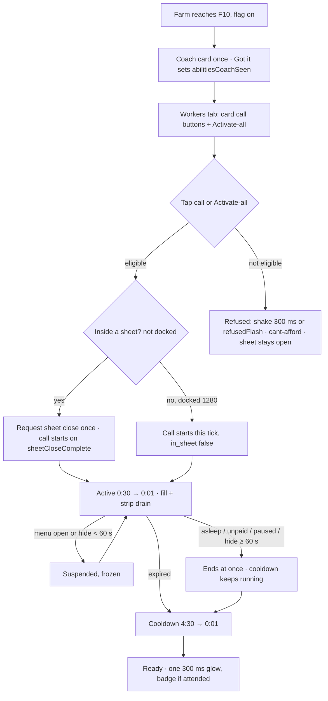
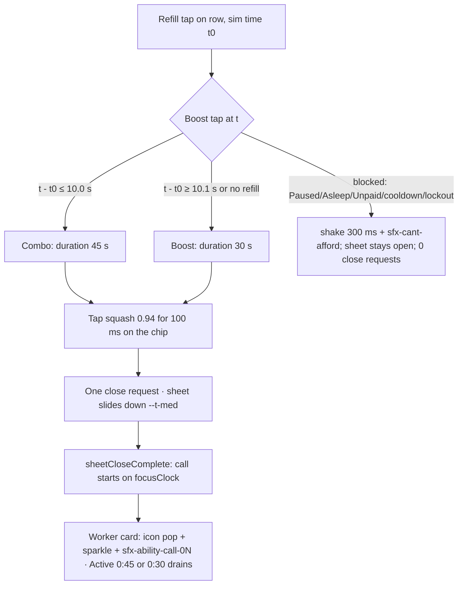

# M5 Abilities flows: Shift calls (Rush · Sweep · Shout · Inspect) + Activate-all · Art & UX · v0.2
2026-10-30 13:40 CET (v0.1 13:12 CET bbe9d142, backup `art-ux/scratch/m5-abilities-flows.v0.1-bbe9d142.bak.md`) · Owner: Head of Art & UX · PM: PM Workers · **Status: v0.2 SIGNED 2026-10-30 13:47 CET; Q8 erratum 2026-11-05 20:28 CET** (signatures in art-ux/decisions.md). Q7 and Q9 are closed; Q8 is closed by the docked-label fallback below.
**v0.2 changes:** PMW Q1–Q4 answers folded in (§14); the **Shift sheet Boost slot** (D-HOP-2026-10-30-35) and the **refill→Boost combo, in v5** (D-HOP-2026-10-30-39) are new §16 with AB-UI-14…24; names now use the signed refill markup (`.lbl` + inline `.sr-in`, `art-ux/reviews/m5-refill-axe/sr-markup.md`), which closes F1/Q5; AB-UI-6 follows HoQA 13:20 (axe name-mismatch inapplicable); AB-UI-13 rewritten for the Boost slot; call sounds delivered (§7, §11); combo icon `ico_boost_combo.svg` (CC0).
Flag: `m4.flags.abilities` (needs `m4.enabled`; default 0, ship value 1, manifest rows 15/18/19). It interacts with `m4.flags.pause` (needs abilities = 1, D-HOP-2026-10-30-16 (1)) and `m4.flags.rc2Refill` / `autoRefill`.
**Relation to the 2026-10-24 sign-off (gate card #7 question):** this flow **extends** `art-ux/m5-workers-ui-signoff.md` (5910646c) and its 16:22/16:25 amendments; it does not replace them. Everything signed there stands except the four deltas in §13 (D1–D4). Each delta needs a PMW errata to the spec; Art doesn't edit product files.

**Specs of record:** `product/workers/m5-worker-abilities-spec.md` **v1.3.7 314dc0e3** (13:38 CET, D-PMW-2026-10-30-17, carries D5–D7 and the manual-only combo; supersedes v1.3.6 c87c57c7, a mid-edit write, final v1.3.6 8797f5ff) (D-PMW-2026-10-30-13: combo in v5, rule 11, AC-M5A-24; v1.3.5 eb33aad0 is the frozen copy `m5-worker-abilities-spec.eb33aad0.md`, which the brief named; v1.3.4 c65dfbc5; rules, ACs AC-M5A-1…24) · `product/workers/rc2-refill-proposal.md` v1.3.6 1fba0ce5 (AC-RF4 combo, B1) · **signed** `art-ux/m5-refill-flows.md` v1.0.1 43828d0b (row anatomy, 253 px floor, CW-AC10) + `art-ux/reviews/m5-refill-axe/sr-markup.md` cc763196 (required name markup) · `product/workers/m5-worker-pause-spec.md` v1.3.10 b4f86ca8 (lockout 45 s, toggle) · ranking `product/m5-value-ranking.md` bfdfd73e (abilities = rank 7, "Art is open") · `engineering/v5-rc-manifest.md` 86a20c9e (rows 15/18/19 `flag-only`, ship value 1) · `engineering/m5-build-plan.md` 2e32b078 (4b+4c on lane U, build-complete Tue 3 Nov 09:00) · gate card #7 in `product/m5-gate-acs.md` c86a93f8.
**Models:** `art-ux/m5-refill-flows.md` v1.0 6173f757 (structure, Shift sheet, markup, RF-UI ACs) · `art-ux/m4.2-fatigue-visibility-ux.md` v1.2 3e4dbc9f (icon style, errata form) · `art-ux/layout-spec.md` v1.5/1.6 5ffb58f3 (tokens) · `art-ux/m5-layout-rects-960.md` 54a59d49 (dock = min-width 960 **and** landscape) · `product/market/sales-stopped-spec.md` (now **v1.3.17** cf26865c; brief cited v1.3.15; §7.3 naming unchanged).
**Naming:** the Market Hand call is **Rush**. **Rush Hour** is the M5.2 Market event only (sales-stopped §7.3). No v5 surface shows "Rush Hour".
**Evidence:** `art-ux/reviews/m5-abilities-fit/` (fixture, run scripts, results, SHA256SUMS). Mocks: `art-ux/mocks/m5-abilities-*.png`.

## 1. Goals
1. Each worker card has one call button. One tap fires it, and Activate-all fires every ready call. Calls never cost anything in v5.
2. Every state reads as text + shape, never colour alone. A blocked tap is never silent.
3. Timers read m:ss, rounded up, never `0:00`. Digits never reach an accessible name (ba398b6 pattern).
4. The card stays 128 px, and Activate-all never moves (AC-M5A-8/9).
5. With `abilities` = 0 the build is today's rc/v5 (AB-AC1); nothing in this doc renders.

## 2. Tunables (all exist; no new numbers)
CSV: `tc_ability_s` 30, `tc_ability_cd_s` 300, `tc_ability_unlock_farm` 10, `tc_ability_w1_price_mult` 1.15, `tc_ability_w2_lay_mult` 1.15, `tc_ability_w3_price_mult` 1.15, `tc_ability_w4_tier_add` 0.5, `leave_attended_window_s` 30. balance.json: `m4.fx.maxActive` 8. Pause: MH lockout 45 s. **No string in this doc hard-codes 30, 300, 45 or 15%**; all are rendered from these keys.

## 3. Entry points
| # | Surface | Shows | When |
|---|---|---|---|
| E-1 | **Worker card call button** (action row slot 3, `[pause 44] 8 [Manage] 8 [call]`) | one per hired worker; Grader only from F18 when hired | F ≥ 10, flag on. **The only per-ability entry point.** |
| E-2 | **Activate-all**, Workers tab sticky bar, right slot (portrait/sheet) | `Shift calls (N)` | F ≥ 10 and ≥ 1 hired |
| E-2d | **Activate-all, 1280/960 docked**: Upgrades panel header, 8 px right of `desk-manage-all` | same | same |
| E-3 | **Ready badge** ([bolt] + N), Workers tab label and Upgrades nav icon top-left −4/−4 | non-interactive | N ≥ 1 and attended |
| E-4 | **Coach card** `Shift calls unlocked!` | once per save | first F10 |
| E-5 | **Shift sheet row Boost slot** (rc2Refill = 1) | one 44×44 Boost chip per row, right of the role/status lines (§16); the sheet header Activate-all slot stays hidden | `abilities && rc2Refill`, F ≥ 10, worker hired (D-HOP-35) |
The sticky bar left slot by flag: `rc2Refill` = 0 → today's rc/v5 bulk `Refill` bar (#83 label; the spec's "Manage all"). `rc2Refill` = 1 → there is no bulk Refill (AC-RF1), so the left slot keeps its 160 px box with `visibility:hidden` and Activate-all stays in the right slot (AC-M5A-9 holds, 0 px move). Docked with `rc2Refill` = 1, the left neighbour is the docked Refill opener (refill-flows §4.3).

## 4. Call button (E-1), per ability
Button: `flex:1 1 0`, 44 px tall (secondary target), 2 px `--c-outline` border, radius 12, padding `0 8px`, Fredoka 700 14 px, `white-space:nowrap`, icon 20 px + 6 px gap, `aria-hidden` icon. Disabled states use `aria-disabled="true"`, never `disabled`. No `aria-label` anywhere.
| Ability (worker) | Ready label | Active icon | Effect line for describedby (rendered from tunables) |
|---|---|---|---|
| **Rush** (Market Hand) | [bolt] `Rush` | `ico_ability_rush` | `30-second boost: Market Hand sales earn 15% more.` |
| **Sweep** (Coop Hand) | [bolt] `Sweep` | `ico_ability_sweep` | `30-second boost: hens lay 15% faster.` |
| **Shout** (Hawker) | [bolt] `Shout` | `ico_ability_shout` | `30-second boost: every sale earns 15% more.` |
| **Inspect** (Egg Grader, F18+) | [bolt] `Inspect` | `ico_ability_inspect` | `30-second boost: grade bonus +0.5.` |

**4.1 States** (first match wins, spec rule 4 order: Asleep > Unpaid > Paused > lockout > active/cooldown > ready)
| State | Visible | DOM, in this order (ba398b6 pattern) | Accessible name | describedby | Look |
|---|---|---|---|---|---|
| Ready | [bolt] `Rush` | icon · text `Rush` · `.sr` `, Market Hand` | `Rush, Market Hand` | effect line | `--c-yolk` fill, ink text 8.6:1 |
| Active | [ico_ability_rush] `Active 0:21` | icon · text `Active` · `<span aria-hidden="true" data-cd=" 0:21">` · `.sr` `, Rush, Market Hand` | `Active, Rush, Market Hand` | `Ready in 4:51` | white base, yolk fill draining 100%→0% over the call, plus a 4 px `--c-text` progress strip on the bottom edge (same width) |
| Cooldown | [bolt] `4:51` | icon · `.sr` `Rush recharging, Market Hand` · `<span aria-hidden="true" data-cd="4:51">` | `Rush recharging, Market Hand` | `Ready in 4:51` | `--c-disabled` #CFC6BA, text #5A4C42 (4.88:1) |
| MH lockout (Pause G2, Rush and Shout) | [icon-pause] `0:45` | icon · `.sr` `Rush after a break, Market Hand` · `data-cd` span | `Rush after a break, Market Hand` | `Ready in 0:45 after a break` | disabled |
| Asleep / Unpaid / Paused | `Asleep` (no icon) | text · `.sr` `, Rush, Market Hand` | `Asleep, Rush, Market Hand` | `Rush is blocked while Market Hand is asleep.` / `… unpaid.` / `… on a break.` | disabled |
| Suspended (menu or hide < 60 s) | `Active 0:21` frozen | as Active, `data-cd` stops | unchanged | unchanged | fill and strip frozen |
- `data-cd` = `m:ss` of `ceil(remaining)`; at `ceil = 0` the state changes that tick, so `0:00` never renders. Cooldown max `5:00`, active max `0:30`, lockout max `0:45`. The E2b read-time cap means it never shows above `5:00`.
- The describedby target is a `.sr` node (not a live region). Its text updates at most once per second and is only read on focus. Spec AC-M5A-3 wording kept.
- The name never contains a digit in any state. Activate-all `Shift calls (N)` is the one exception: N is a count, not a timer, and AC-M5A-10 needs it.
- **Name markup (v0.2):** every `.sr` suffix in §4 and §16 is the signed refill technique: one `.lbl` wrapper with an inline `<span class="sr-in">` (`font-size:0;line-height:0;color:transparent`), never `position:absolute` and never `aria-label` (`art-ux/reviews/m5-refill-axe/sr-markup.md`). The old absolute `.sr` gave `Rush , Market Hand` in Chromium (F1). The describedby targets stay ordinary off-screen `.sr` nodes (they are not part of a name).
- **Why no word on the cooldown label:** `Inspect 4:51` would leave about 2 px at 124 px (pause on), so the signed time-only label (Art Q7e) stays. The role name is one line above on the same card.

**4.2 Activate-all (E-2)**, 48 px tall (primary), 160 px at 360 / 175 at 390 (two-slot bar). Docked (E-2d, Q8 erratum): when Refill is visible, Activate-all is a **48 px-high compact button** in the Upgrades header, 8 px right of Refill, not a second row. Visible content is bolt + `Shift calls (N)`, bolt + `Next call 4:51`, or bolt + `No calls ready`, using the signed `data-cd` countdown. Its width is content-sized with 8 px horizontal padding and a 2 px border; the widest signed label must fit the 61.953 px measured free space, so the docked visible labels shorten to bolt + `N`, bolt + `4:51`, or bolt + `—`, respectively. The full accessible names remain exactly `Shift calls (N)`, `Next call`, or `No calls ready`, with the §4.2 describedby, via inline `.sr-in`; no aria-label and no digit in a name. The bolt is `aria-hidden`. When Refill is not visible, the full signed ≥132 px label is retained. Refill stays unchanged; never icon-only.
| State | Visible | DOM | Name | describedby |
|---|---|---|---|---|
| ≥ 1 eligible | [bolt] `Shift calls (N)` on `--c-yolk` | icon · text | `Shift calls (N)` | `Use N ready shift calls` |
| 0 eligible, one not blocked | [bolt] `Next call 4:51` on 50% yolk #FFE49E (ink 10.6:1) | icon · text `Next call` · `data-cd=" 4:51"` | `Next call` (**D1**) | `Next call ready in 4:51` |
| all blocked | [bolt] `No calls ready` | icon · text | `No calls ready` | — |

**4.3 Badge (E-3), coach (E-4):** as signed (§3/§5 of 5910646c). The badge stays `aria-hidden`; the Upgrades nav name gains a `.sr` suffix `, N shift calls ready` (name `Upgrades, 2 shift calls ready`). Coach `Got it` is 48 px (primary). Reduced motion: no scale-in, the card appears with a 150 ms fade.

## 5. Flows


## 6. Wireframes (measured: §9; mocks `art-ux/mocks/m5-abilities-card-*-360-{1,2}x.png`)
**360 · Workers sheet, pause flag on**
```
┌──────────────────────────────────┐ 360 (328 content)
│ [ Refill (3) ] 8 [⚡ Shift calls (4)] │ 160 · 8 · 160, 48 tall (⚡ = icon-bolt.svg)
├──────────────────────────────────┤
│ ▢ Market Hand · Working          │
│   Energy 72%                     │
│ [⏸] [  Manage  ] [⚡ Rush      ] │ 44 · 8 · 124 · 8 · 124, card 128
│ ▢ Coop Hand · Working            │
│ [⏸] [  Manage  ] [sweep Active 0:21] │ yolk fill 70% + 4px strip
│ ▢ Hawker · Working               │
│ [⏸] [  Manage  ] [⚡ 4:51      ] │ cooldown, disabled grey
│ ▢ Egg Grader · Asleep            │
│ [⏸] [  Manage  ] [  Asleep     ] │
└──────────────────────────────────┘
```
**1280 docked** (400 px column, 348 card content): header `Upgrades … [Refill] 8 [⚡ Shift calls (4)]`; cards as above with 144 px Manage/call (170 with pause off). Mock `m5-abilities-card-active-1280docked-{1,2}x.png`.

## 7. Juice hooks (for Audio & Juice; all ≤ 400 ms, reduced-motion fallback each)
| Hook (event) | Visual | Sound | Reduced motion |
|---|---|---|---|
| `ability.fire` (per call; `ability_used`) | icon pop 1→1.15→1 in 200 ms; 6-dot sparkle on the card (`data-fx`, cap 8, oldest evicted) | **4 files, one per call** (Audio, delivered 13:23): `sfx-ability-call-01` Rush (ogg c032ede8, 0.34 s), `-02` Sweep (d89bc67a, 0.36 s), `-03` Shout (394ffedb, 0.30 s), `-04` Inspect (3d4c40a3, 0.38 s), each `.ogg` + `.mp3` in `art-ux/assets/sfx/` | no pop, no sparkle; fill appears at 100% |
| `ability.fireAll` (Activate-all) | one sparkle per fired card, under the same cap | **one** sound only: the file of the **first card it fires** (audio-hooks v1.5), not N sounds | as above |
| Boost (§16.5) | tap squash → sheet close → on `sheetCloseComplete` the `ability.fire` row above, on the **worker card** | the call's own file, once, at call start (not at tap) | squash and close are instant; no pop/sparkle |
| `ability.end` (expired) | the fill reaches 0; the icon swaps back to bolt with a 150 ms crossfade | none (Art proposal; Audio may add a soft tail) | instant swap |
| `ability.endEarly` (asleep/unpaid/paused/offline) | the fill drops to 0 with a 150 ms fade | none | instant |
| `ability.ready` (cooldown done) | one 300 ms yolk glow on the button, never looping; badge scale-in 300 ms (signed) | none (avoids noise while idle) | no glow, no scale-in |
| `ability.blocked` (refused tap) | shake 300 ms | `sfx-cant-afford-0x` (exists) | `refusedFlash` 300 ms (#83 keyframe, extended to `.call`) |
| `ability.suspend` / `resume` | fill and strip freeze or resume; no FX | audio follows audio-hooks §80 (timers freeze in menus) | same |
| *Sound is never the only signal:* every hook above has a visual (and the state change in the label/name); with audio muted nothing is lost. | | | |
| `abilities.unlocked` (coach) | card fade + rise 8 px, 240 ms | reuse `sfx-milestone-01` | 150 ms fade |

## 8. Edge cases
1. **Fired inside the sheet** (portrait, 959×600, portrait ≥ 960): one close request; the call starts on `sheetCloseComplete`, so the player sees it running on the farm. Docked 960×600 and 1280: no close (AC-M5A-22).
2. **Shift sheet open (rc2Refill = 1), docked or portrait:** it is a menu, so a running call is suspended and the button shows the frozen `Active`. Q2 confirms it.
3. **Activate-all with mixed states:** fires the eligible ones in one pass; blocked cards don't shake (only a tapped control refuses).
4. **Asleep, Unpaid or Paused mid-call:** the label switches to the word that tick, and the cooldown still shows once the block clears.
5. **Pause on Market Hand → Resume:** Rush and Shout show [pause] `0:45` → `0:01`. A Coop Hand Resume gives no lockout.
6. **Tired:** the call works and the label is unchanged (no "Too tired" state exists).
7. **Grader hired at F18+:** the new card is Ready, N + 1, and the badge scales in once.
8. **Reload or hide ≥ 60 s mid-call:** returns showing cooldown, never Active.
9. **Clock rollback:** the display caps at `5:00`.
10. **CSR fresh start below F10:** no call UI, badge or coach.
11. **Frenzy at the same time:** no visual conflict; FX share the 8 cap, Frenzy flyers have no `data-fx`.
12. **Coach vs other hints:** the coach never overlaps Buy, Collect or Activate-all; it queues behind recovery and welcome-back.
13. **1 or 2 hired workers:** the bar shows from 1 hired; N counts hired only.
14. **Rush naming:** no v5 surface shows "Rush Hour"; the event is M5.2.
15. **Boost, combo and Shift sheet cases:** §16.6.

## 9. Fit check (build fonts `wt-m41-p2/dist-qa/fonts` Fredoka 700; Chromium 156, Firefox 157, WebKit 27.2; `art-ux/reviews/m5-abilities-fit/fit2.json`)
| Control (14 px, 20 px icon + 6 gap, 8 px padding, 2 px border) | Widest label (all `data-cd` values swept) | Content px (Cr / FF / WK) | Button px at 360 / 390 / 1280 docked (pause on · off) | Least spare | Result |
|---|---|---|---|---|---|
| Call · Ready | [bolt] `Inspect` | 71.64 / 71.62 / 71.64 | 124 · 150 / 139 · 165 / 144 · 170 | 32.4 | fits |
| Call · Active | [icon] `Active 0:22` (widest digits) | 97.55 / 97.50 / 97.53 | same | **6.45** (360, pause on) | fits |
| Call · Cooldown | [bolt] `2:22` | 52.88 / 52.85 / 52.87 | same | 51.1 | fits |
| Call · Lockout | [pause] `0:22` | 52.86 / 52.85 / 52.86 | same | 51.1 | fits |
| Call · Asleep / Unpaid / Paused | `Paused` | 45.73 | same | 58.3 | fits |
| Manage | `Manage` | 49.98 | same | 54.0 | fits |
| Activate-all (48 tall) | `No calls ready` (`Next call 2:22`: 27.0 spare) | — | 160 / 175 (bar slot; the fixture's 180 docked slot is a proxy, the real docked header is Q8) | 23.96 | fits |
- No label clips (`scrollWidth ≤ clientWidth`) or wraps in any engine, width or pause setting. Card 128 px in every case; every call/Manage button 44 px; Activate-all 48 px; its rect moves 0 px when the left slot hides (all 3 engines).
- The tightest case is `Active 0:22` at 124 px (6.45 px spare). Any longer active word (localisation) must drop the word, not the digits.
- Method note: run 1 (`results.json`) measured content with a Range that included the clipped `.sr` text and gave meaningless negative spares; `fit2.cjs` excludes `.sr` (it is `position:absolute` and takes no space). Run 1's clip, row-overflow, height and axe results are valid.

## 9a. axe and names (`results.json`)
- axe-core 4.14.0 on 7 states × 360/390/1280 × 3 engines: `label-content-name-mismatch` **0**, full pass **0 violations, 0 incomplete**. 0 `aria-label` on any call or Activate-all control.
- **v0.2:** F1 is fixed by the signed `.lbl` + `.sr-in` markup (§4 note); the Boost slot run (§16.3) gives exact names in CDP, `ariaSnapshot` and axe in all 3 engines. The v0.1 run below used the old absolute `.sr` and is history.
- Names (Playwright `ariaSnapshot`): `Next call`, `Shift calls (4)`, `Rush recharging, Market Hand`, `Rush after a break, Market Hand`. **Finding F1:** where the `.sr` suffix starts with a comma, the snapshot reads `Rush , Market Hand` (a space before the comma), because `.sr` is `position:absolute` and accname treats it as a block. Chromium's own AX tree (CDP `Accessibility.getFullAXTree`, `fit2.json`) gives the same `Rush , Market Hand` / `Active , Rush, Market Hand`, so it is real, not a snapshot quirk. Screen readers read it normally, but exact-string name checks fail. This applies equally to Refill's `Refill, {Role}` names (failure-cost v0.3.19), so it goes to HoQA as a test-method note (Q5), not a design change.

## 10. Contrast and targets
- Text: ink on yolk 8.6:1, on white 13.21:1, on 50% yolk 10.6:1, disabled #5A4C42 on #CFC6BA 4.88:1. All ≥ 4.5:1.
- UI: the 2 px outline is ≥ 7.8:1 on every fill. The yolk fill alone is 1.54:1 on white, so it is decoration only; progress is carried by the 4 px ink strip (13.21:1) and the digits.
- State is never colour alone: each state differs by icon (bolt / ability icon / pause / none) and by word or digits.
- Targets: Activate-all 48 tall; call, Manage and pause 44 tall; 8 px gaps; coach `Got it` 48.

## 11. Assets
| Asset | Use | Status | sha1 |
|---|---|---|---|
| `ico_ability_rush.svg` | Active icon, Rush (coin + up arrow + speed lines) | **new, CC0** | `97302bb3` |
| `ico_ability_sweep.svg` | Active icon, Sweep (broom + egg) | **new, CC0** | `88fa42ff` |
| `ico_ability_shout.svg` | Active icon, Shout (megaphone + 2 arcs) | **new, CC0** | `6d466111` |
| `ico_ability_inspect.svg` | Active icon, Inspect (magnifier + star) | **new, CC0** | `3cdebd58` |
| `icon-bolt.svg` (= ready/cooldown icon, badge, Activate-all) | exists (2026-10-24) | reused | `a54952d1` |
| `icon-pause.svg` (= lockout) | exists | reused | `97291783` |
| `ring-cooldown.svg` | **not used on the call button** (D3) | exists | — |
| `sfx-cant-afford-0x`, `sfx-milestone-01` | refused, coach | exist | — |
| `sfx-ability-call-01…04` (.ogg + .mp3), one per call | fire | **delivered by Audio 13:23 CET (resolved)**; ogg sha256 c032ede8 / d89bc67a / 394ffedb / 3d4c40a3; 0.30–0.38 s (ffprobe) | — |
| `ico_boost_combo.svg` | Boost combo cue (§16) | **new, CC0** (bolt + white plus badge; LICENSES.md entry added) | see SHA256SUMS |
- Style: 48 viewBox, 2 px #3E2C23 round outline, house palette (yolk #FFC93C, amber #F29E1F, barn #D9534F, sky #8FD3F4, wood #A86B3C), same as `ico_fatigue_*`. Legible at 12 and 20 px on white and on #CFC6BA: `art-ux/mocks/m5-abilities-icons-1x.png` / `-2x.png`. Each silhouette is different, so greyscale still separates them.
- LICENSES.md entry added (art-ux/assets/LICENSES.md, 2026-10-30).

## 12. UI acceptance criteria (Chromium/Firefox/WebKit; 360×640, 390×844, 1280×800 docked; maps to gate card #7)
- **AB-UI-1** `abilities` = 0: no `[data-act^="ability"]`, no badge, coach, Activate-all or `ico_ability_*` request; screenshots match the rc/v5 flags-0 golden (AB-AC1).
- **AB-UI-2** Each call button is 44 ±1 px tall, `flex-grow:1`, and the same width as Manage: 124/150 at 360, 139/165 at 390, 144/170 docked (pause on/off) ±1. The card is 128 ±1 px. Gaps 8 ±1.
- **AB-UI-3** Every label in §4.1, with every `data-cd` value it can reach (active `0:01`…`0:30`, cooldown `0:01`…`5:00`, lockout `0:01`…`0:45`), for all four abilities: 1 line, `scrollWidth ≤ clientWidth`, ≥ 14 px, after `document.fonts.ready`.
- **AB-UI-4** No rendered timer reads `0:00` or `Ns`; values are `ceil` ±1 s.
- **AB-UI-5** The DOM order per §4.1: text node (where one exists), then the empty `aria-hidden` `data-cd` span, then `.sr`. No `aria-label` on any call or Activate-all control. The computed name has no digit in any call state (CDP `getFullAXTree` + `ariaSnapshot`, whitespace-normalised).
- **AB-UI-6** axe 4.14 full pass with 0 violations on the 7 call states + 3 Activate-all states, 3 engines × 3 widths. *(v0.2, HoQA 13:20 / AC-M5A-23:* `label-content-name-mismatch` is inapplicable to content-named controls; the name oracle is "no `aria-label` and the exact computed name equals X", AB-UI-5 without normalisation.)
- **AB-UI-7 (Q8 erratum)** Activate-all: 48 ±1 tall; 160/175 ±1 wide at 360/390. Docked with Refill visible: compact §4.2 labels (`N` / `4:51` / `—`), 8 ±1 px right of Refill, 48 ±1 tall, content width no greater than the measured free run, 0 clip and no header wrap; exact §4.2 name via `.sr-in`, no aria-label. Without Refill: full ≥132 px label, and toggling Refill never moves the control (AC-M5A-9). Evidence: #86 F6 `05a1e014282d0e91b7b039d0d1bf212993773556` has only 61.953 px free with Refill visible at both 960×600 and 1280×720, so the old 132 px occupied-docked requirement is withdrawn. Verify the three compact states at 960×600 and 1280×720 in all 3 engines at the final RC.
- **AB-UI-8** Active: the fill and the 4 px strip are 100% ±2 at t = 0, 50% ±2 at 15 s, gone at 30 s (AC-M5A-18); the icon is the ability's own. Under a menu both freeze.
- **AB-UI-9** Every refused tap shakes and plays cant-afford; with reduced motion, `refusedFlash`. A refused tap in the sheet issues 0 close requests.
- **AB-UI-10** Contrast per §10; each state is still identifiable in a greyscale screenshot (icon + word/digits).
- **AB-UI-11** Motion ≤ 400 ms, none loops; with `prefers-reduced-motion` only the fades in §7 run.
- **AB-UI-12** No text node contains U+26A1, U+23F8, U+25B6 or "Rush Hour".
- **AB-UI-13 (rewritten v0.2)** With `rc2Refill` = 1: the sheet header shows no Activate-all; the Workers-tab sticky-bar left slot is `visibility:hidden` and Activate-all keeps its rect. Each Shift sheet row has **exactly one** call control, the Boost slot (§16), iff `abilities` = 1 **and** `rc2Refill` = 1; with either flag 0 the slot is absent from the DOM (not hidden) and the row matches signed refill-flows v1.0.1 (161 ±1 px row).

## 13. Deltas from the spec / 2026-10-24 sign-off (each needs a PMW errata; none changes a rule or number)
| # | Delta | Why |
|---|---|---|
| D1 | AC-M5A-10 / AB-AC9: disabled Activate-all **name** is `Next call` (not `Next call m:ss`); the time moves to describedby | ba398b6 pattern, no digits in names |
| D2 | Call names gain the `.sr` role suffix (§4.1); cooldown/lockout names are `{Call} recharging, {Role}` / `{Call} after a break, {Role}` | name and role for screen readers; brief rule |
| D3 | §5.5's "30 s ring on the call button" is dropped; the draining fill + 4 px strip is the only active timer (AC-M5A-18) | two timers on one 124 px button; no room for a 48 px ring |
| D4 | AC-M5A-8 "Active at 0:30 and 0:00": `0:00` never renders, so the fit set is `0:01`…`0:30` | timer rule |

## 14. Open questions (owner in bold)
*v0.2 status: Q1–Q4 answered by PMW 13:14 CET and accepted (spec v1.3.4/§5.6); Q1's Boost part superseded by D-HOP-35/39 (§16). Q2: build dependency UI F6 `overlay.wireAttended` PR #86. Q5 closed by the signed `.sr-in` markup. Q6 closed: sounds delivered. Q9 is ruled by Art (13:42; AB-UI-15). **Q7 is closed (HoE 13:38):** the '+0.5' is the base value `tc_ability_w4_tier_add`, which the copy reads from data, never hard-coded, and is not mood-scaled. **Q8 is closed (Art 2026-11-05):** the occupied docked header has 61.953 px free at 960×600 and 1280×720, so the compact 48 px-high Activate-all fallback in §4.2/AB-UI-7 applies when Refill is visible. Build start depends on #86 and the abilities-lane Shift sheet (sheetCloseComplete). HoE confirms 0.75 dd, 1.0 high.*
1. ~~**PMW (with HoP):** with `rc2Refill` = 1, does Activate-all stay in the Workers-tab right slot (Art's recommendation: no rule change, AC-M5A-8/9/22 hold) or move to the Shift sheet header (rc2 proposal line 8, refill-flows' hidden slot)? And does the Shift row Boost slot stay hidden in v5 (combo is M5.1, not in the manifest)?~~ Answered.
2. **PMW + HoE:** is the Shift sheet a menu for `focusClock` at every width, including the docked overlay? (Refill-flows treats it as one for toasts.)
3. **PMW:** accept the describedby copy in §4 (effect lines, blocked sentences) and errata D1–D4.
4. **PMW / PM Market:** confirm the MH call keeps the name `Rush` for v5 (sales-stopped §7.3 says rename before M5.2 Rush Hour). Not blocking v5.
5. **HoQA:** for AB-UI-5 and the Refill names, normalise whitespace before punctuation in name checks, or require CDP `getFullAXTree` as the oracle (finding F1).
6. **Audio & Juice:** make `sfx-ability-call-0x` (3 variants) and confirm no sound on end/ready.
7. **HoE:** the Inspect effect line says `grade bonus +0.5`; confirm that's the number shown, since `tc_ability_w4_tier_add` is additive and scaled by mood.
8. ~~**HoE (UI lane): docked header fit.**~~ Closed by Q8 erratum, 2026-11-05: compact Activate-all with Refill visible, full label without Refill; no second header row and no icon-only Refill. Evidence `artifacts/v5-q8-docked-header/q8B-refill-measurements.json`.
9. **Head of Art & UX → PMW/HoP:** the §16.2 fold test ("row 4 starts above the fold at 360×640") cannot pass with **any** Boost placement: the signed v1.0.1 sheet with no Boost already starts row 4 at y = 773 vs fold 640. Proposed replacement bar: Boost adds ≤ 4 px per row and 0 px to the action line (AB-UI-15).

## 15. Not in scope
Economy numbers (combo tunables are Econ's, Sat 31 Oct 18:00 CET), charges, energy cost (0 in v5), Rush Hour (M5.2), worker sprites on the farm scene (none in v5).

## 16. Shift sheet Boost slot (E-5) and the refill→Boost combo (v0.2; D-HOP-2026-10-30-35 and -39)
Rendered iff `m4.flags.abilities && m4.flags.rc2Refill`. The slot **is** that worker's call (spec rule 10 in-sheet entry, E14): one tap fires it, logs only `ability_used{in_sheet:true}`, shares the card button's cooldown, lockout and blocks. **Combo (spec rule 11, AC-M5A-24, rc2 AC-RF4):** a Boost tapped ≤ `combo_window_s` (10.0 s) of sim time after that worker's Refill tap lasts `combo_boost_duration_s` (45 s), otherwise `tc_ability_s` (30 s); 10.1 s does not qualify. No string hard-codes 10, 30 or 45. Combo values are pending Econ (Sat 31 Oct 18:00 CET); a change is copy-free.

**16.1 Placement: chip on the name/status lines (PMW fallback (3)).** One placement at every width (PMW 13:22; inline-at-≥390 dropped).
- 44×44 hit box = visible box, grid column 2 of the row's top block (`grid-template-columns:minmax(0,1fr) 44px; column-gap:4px`), spanning line 1 (role, pill, $/s at risk) and line 2 (energy/times). Icon 18 px over one visible word or `m:ss`, Fredoka 700 11/12 px (the state-pill size), radius 12, 2 px outline. Never icon-only.
- The action line is **untouched**: Refill `flex:1; min-width:253px` (276×48 at 360, CW-AC10) + 8 + Rest 44×44, exactly signed v1.0.1. Refill stays the only 48 px primary and the widest target.
- Why not (a), the full-width second action line: it failed PMW's fold test by more (row 4 at 929 vs 773 baseline, +52 px per row), stacks a 328 px yolk bar under Refill so Boost reads as the primary, and puts Boost at the thumb's best spot over Refill. The chip sits top-right of the row, the same column as Rest, so one thumb reaches both, and it is read with the role name at a glance.

**16.2 Measured (fixture `reviews/m5-abilities-fit/sheet-fixture.html`, `boost.cjs` → `boost.json`; Chromium 156.0.8078.47, Firefox 157.0, WebKit 27.2; build fonts; identical in all 3 engines; rects x,y,w×h in CSS px, first row)**
| Viewport | Option | Row h | Row 4 top / fold | Boost | Refill | Rest |
|---|---|---|---|---|---|---|
| 360×640 | none (signed v1.0.1) | 161 | 773 / 640 **fail** | — | 16,367 276×48 | 300,369 44×44 |
| 360×640 | (a) line | 213 | 929 / 640 **fail** | 16,423 328×44 | 16,367 276×48 | 300,369 |
| 360×640 | **(b) chip** | **165** | 785 / 640 **fail** | **300,263 44×44** | 16,371 276×48 | 300,373 |
| 390×844 | none | 161 | 824 / 844 pass | — | 16,418 306×48 | 330,420 |
| 390×844 | (a) | 213 | 980 / 844 fail | 16,474 358×44 | 16,418 306×48 | 330,420 |
| 390×844 | **(b)** | 165 | 836 / 844 pass | 330,314 44×44 | 16,422 306×48 | 330,424 |
| 1280×800 docked | none | 161 | 669 / 800 pass | — | 898,263 314×48 | 1220,265 |
| 1280×800 docked | (a) | 213 | 825 / 800 fail | 898,319 366×44 | 898,263 314×48 | 1220,265 |
| 1280×800 docked | **(b)** | 165 | 681 / 800 pass | 1220,159 44×44 | 898,267 314×48 | 1220,269 |
- **Fold test:** (a) fails, so (b) is used as PMW directed. (b) also misses the literal test at 360×640, but so does the signed sheet with **no** Boost (773 > 640: header 56 + next-charge line + three 161 px rows with the Auto-refill row). No placement can pass; (b) costs +4 px per row (+12 px to row 4), (a) +52. Ruling needed (§14 Q9).
- Line 1 at 360 gets 280 px (worst `Market Hand` + `Refillable` + `$999.9M/s at risk` = 276.2, refill-flows §9): 0 overflow in every engine/width.
- **Layout shift 0.00 px** (Boost rect, Refill rect, row height) across all 8 states × 4 workers × every `m:ss` (active 0:01–0:45, cooldown 0:01–5:00, lockout 0:01–0:45), all engines/widths, and across the combo window expiring (§16.6).
- **Label fit in the 40 px inner box** (worst over workers and values, all engines ±0.02): `Boost` 11.45 spare · `Combo` 5.98 · active `0:22` 18.89 · cooldown `2:22` 18.87 · lockout 18.89 · `Paused` **4.06 (tightest)** · `Asleep` 6.00 · `Unpaid` 5.41. 0 clip, 1 line. 11 px is below the card labels' 14 px floor (AB-UI-3); it matches the signed state pill and is an Art exception for this chip only.
- Renders: `art-ux/wireframes/m5-boost-{none,line,name}-{360x640,390x844,1280x800d}-{chromium,firefox,webkit}.png`, combo/expired `m5-boost-name-{combo,expired}-360x640-{engine}.png`.

**16.3 States, names, describedby** (first match wins, spec rule 4 order; `aria-disabled="true"`, never `disabled`; no `aria-label`; DOM per sr-markup: icon (`aria-hidden`) · `.lbl` [ text · empty `aria-hidden` `data-cd` span · `.sr-in` ] )
| State | Visible (icon + text) | Look | Exact name (no digit, no space before a comma) | describedby |
|---|---|---|---|---|
| Ready | `icon-bolt` + `Boost` | yolk, ink 8.6:1 | `Boost, {Call}, {Role}` e.g. `Boost, Rush, Market Hand` | `30-second boost: {effect} Starts when the sheet closes.` |
| **Combo** (ready, ≤ 10.0 s since this worker's Refill tap) | `ico_boost_combo` + `Combo` | yolk, ink | `{Call}, Combo, {Role}` e.g. `Rush, Combo, Market Hand` | `Combo, 45-second boost: {effect} Starts when the sheet closes.` (errata 13:58 SG-4: one colon, parallel to Ready; 30/45 read from data) |
| Active (frozen while the sheet is open, rule 10) | `ico_ability_{call}` + `m:ss` | white + yolk fill + 4 px ink strip, frozen | `Active, {Call}, {Role}` | `Ready in m:ss` |
| Cooldown | `icon-bolt` + `m:ss` | disabled #CFC6BA, text #5A4C42 4.88:1 | `{Call} recharging, {Role}` | `Ready in m:ss` |
| MH lockout | `icon-pause` + `m:ss` | disabled | `{Call} after a break, {Role}` | `Ready in m:ss after a break` |
| Paused (Rest on; AC-RF4) | `icon-pause` + `Paused` | disabled | `Paused, {Call}, {Role}` | `{Call} is blocked while {Role} is on a break.` |
| Asleep | `icon-moon-ink` + `Asleep` | disabled | `Asleep, {Call}, {Role}` | `… is asleep.` |
| Unpaid | `icon-warn` + `Unpaid` | disabled | `Unpaid, {Call}, {Role}` | `… is unpaid.` |
- **Name evidence** (`boost.json`, `boost2.json`): all 8 states × 4 workers equal the table exactly in Chromium CDP `getFullAXTree`, `ariaSnapshot` (3 engines) and axe `accessibleTextVirtual` (3 engines); 0 `aria-label`. **Combo copy note:** the brief's `{Call}, combo, {Role}` (lower-case) was tried with CSS `text-transform:capitalize` on the visible word: `ariaSnapshot`/axe gave `Rush, combo, Market Hand` but Chromium CDP gave `Rush, Combo, Market Hand` (`boost2-run1-texttransform.json`). Art's copy is therefore **`{Call}, Combo, {Role}`** with the plain DOM word `Combo`, identical in every oracle. PMW to mirror in §5.6.
- The combo outcome is shown three ways, never colour alone: the `Combo` word + plus-badge icon before the tap, the describedby, and the card's `Active 0:45` start after it.
- Contrast: text ≥ 4.88:1 on every fill; icon outlines #3E2C23 ≥ 7.8:1 (UI ≥ 3:1). Greyscale: every state differs by icon shape and word/digits.

**16.4 Markup**
```html
<button class="bst" type="button" data-act="boost" aria-describedby="bd-mh"><span class="lbl">Boost<span class="sr-in">, Rush, Market Hand</span></span></button>
<button class="bst" type="button" data-act="boost" aria-describedby="bd-mh"><span class="lbl"><span class="sr-in">Rush, </span>Combo<span class="sr-in">, Market Hand</span></span></button>
<button class="bst" type="button" data-act="boost" aria-disabled="true" aria-describedby="bd-mh"><span class="lbl"><span class="sr-in">Rush recharging, Market Hand</span><span aria-hidden="true" data-cd="4:51"></span></span></button>
```
CSS: `.bst{grid-row:1/span 2;grid-column:2;width:44px;height:44px;padding:0;display:flex;flex-direction:column;align-items:center;justify-content:center;gap:1px;font:700 11px/12px Fredoka;border:2px solid var(--c-outline);border-radius:12px;overflow:hidden}` + the sr-markup `.lbl`/`.sr-in` rules. The combo cue is a **state swap inside the same box** (icon + word), so it switches on/off with 0 px re-layout.

**16.5 Flow and feedback (spec v1.3.5 Boost timing, every width incl. docked)**

- The duration is decided at the **tap** (sim time, refill tap → Boost tap) and counted from `sheetCloseComplete`, so a slow close never loses the combo.
- The countdown is seen on the **worker card / Workers tab** after close (and in the HUD calls area as signed). Reopening the sheet shows the chip `Active m:ss` frozen (the sheet is a menu; spec Q2).
- Reduced motion: no squash, instant close, no pop/sparkle; the sound still plays once at call start.

**16.6 Edge cases**
1. **Window boundary:** tap at 10.0 s → Combo/45 s; at 10.1 s → Boost/30 s. Fixture model run at t = 0, 5, 9.9, 10.0, 10.05, 10.1, 10.2: label `Combo` through 10.0, `Boost` from 10.05 (strict `≤ 10.0`), 0.00 px shift in all engines/widths. The label is re-evaluated every sim tick with the same predicate the tap uses, so label and outcome agree at the tap.
2. **Window expires while the sheet is open:** the combo window runs on **sim time** (not `focusClock`), so it keeps running under the open sheet; at 10.1 s the chip swaps `Combo` → `Boost` in place (0 px), the name changes on next focus read, no announcement, no sound.
3. **Refill then Rest (Paused):** chip `Paused` (combo cannot be used); clearing Rest inside the window shows `Combo` again until it expires.
4. **Refill on an Asleep worker:** Refill wakes them; chip goes Asleep → Combo the same tick.
5. **Unpaid:** chip `Unpaid`; Refill is disabled too (refill-flows), so no combo can start.
6. **Cooldown/lockout at refill time:** no combo cue; the chip keeps its timer. A Refill never shortens a cooldown.
7. **Two refills:** the window restarts from the latest Refill tap.
8. **Auto-refill (PMW 13:37 CET, rule 11 / AC-RF4):** only a manual refill (`refill_used{by:manual}`) opens the 10 s combo window, because the combo rewards active management. An auto refill never shows the Combo cue or name. AB test: after an auto refill, a Boost within 10 s shows `Boost` (30 s), not `Combo`. Copy and layout are unchanged.
11. **Card and Activate-all calls never combo** (rule 11: only a Boost from the sheet): the card button shows no Combo cue and always runs `tc_ability_s`. The window is per worker; refilling one row never lights another row's chip.
9. **Flags:** `abilities`=1 & `rc2Refill`=0 → no Shift sheet, card call only. `abilities`=0 → no chip, no combo (AB-UI-1). `rc2Refill`=1 & `abilities`=0 → signed v1.0.1 rows, no chip. `autoRefill` changes nothing here.
10. **Docked:** same chip, same close-on-tap (v1.3.5); the call starts on `sheetCloseComplete` of the docked column.

**16.7 UI acceptance criteria (Chromium/Firefox/WebKit; 360×640, 390×844, 1280×800 docked)**
- **AB-UI-14** Boost chip rect 44 ±1 × 44 ±1, right edge = content right edge, top = row top block top; in the same column as Rest (x within ±1).
- **AB-UI-15** The action line equals signed v1.0.1: Refill ≥ 253 wide (276/306/314 ±1 at 360/390/docked), 48 ±1 tall; Rest 44×44; row height = v1.0.1 row + ≤ 4 px (165 ±1).
- **AB-UI-16** Line 1 and line 2 never overflow, wrap or clip with the chip present (worst copy per refill-flows §9).
- **AB-UI-17** Every §16.3 state, all four calls and every `data-cd` value (active 0:01–0:45, cooldown 0:01–5:00, lockout 0:01–0:45): 1 line, `scrollWidth ≤ clientWidth`, icon + visible text present, never icon-only; never `0:00`.
- **AB-UI-18** 0.00 ±0.5 px movement of the chip, Refill and row across every state change, including Combo ↔ Boost.
- **AB-UI-19** Names: no `aria-label`; the exact computed name equals §16.3 (no normalisation, no digit, no space before a comma) in CDP, `ariaSnapshot` and axe, 3 engines.
- **AB-UI-20** axe 4.14 full pass 0 violations on the sheet in each state set (the fixture's glyph ✕ is an `incomplete`, fixture-only; the build's ✕ uses `icon-close.svg`).
- **AB-UI-21** Combo: a Boost tapped at 10.0 s of sim time after a Refill tap runs 45 ±0.5 s; at 10.1 s, 30 ±0.5 s; the chip shows `Combo` + `ico_boost_combo` exactly while the predicate holds and swaps in place when the window expires with the sheet open.
- **AB-UI-22** A successful tap issues exactly one close request; the call starts on `sheetCloseComplete` at every width incl. docked; one `ability_used{in_sheet:true}`; the call's own `sfx-ability-call-0N` plays once at start; a blocked tap issues 0 close requests and shakes (reduced motion: refusedFlash).
- **AB-UI-23** Under the open sheet a running call's chip shows frozen `Active m:ss`; cooldown digits keep counting.
- **AB-UI-24** With `abilities` = 0 or `rc2Refill` = 0 no `[data-act=boost]` exists and no `ico_boost_combo` is requested.

**16.8 Deltas for PMW errata (no rule or number changes)**
| # | Delta |
|---|---|
| D5 | Boost Ready name `Boost, {Call}, {Role}` (visible word leads, WCAG 2.5.3), not the bare call name |
| D6 | Combo name `{Call}, Combo, {Role}` (capital C, matches the DOM word; lower-case fails Chromium CDP) |
| D7 | Fold-test bar replaced by AB-UI-15 (+≤ 4 px per row), pending Q9 |

**16.9 Engineering estimate (Art view; HoE to confirm):** chip component reusing the card call state machine 0.25 dd; combo predicate + label swap 0.25 dd; sheet close → start wiring exists (E14, PR #86 dependency); tests AB-UI-14…24 0.25 dd. **≈ 0.75 dd, under the 1-day slip line.**
