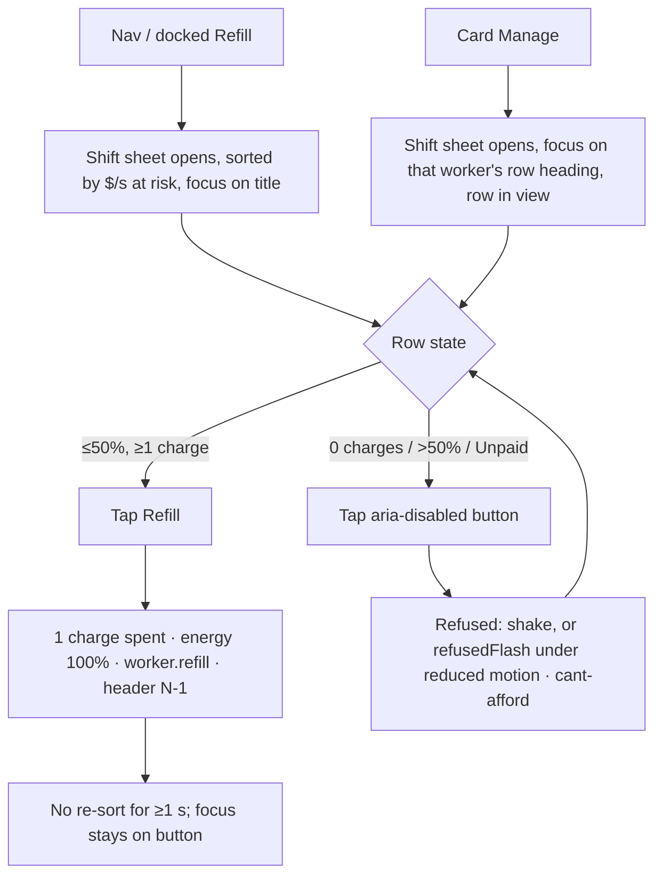
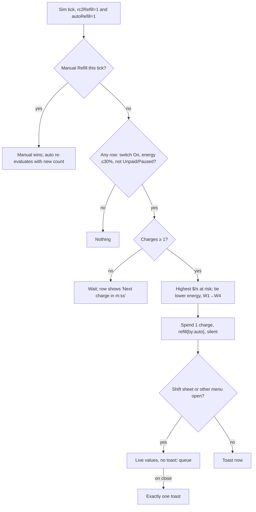

# M5 Refill flows: rc2Refill (manual) → autoRefill · Art & UX · v1.0.1
2026-10-30 12:45 CET (v1.0) · v1.0.1 13:25 CET · Owner: Head of Art & UX · PM: PM Workers · **Status: v1.0.1 ready for Art sign-off: all PMW errata have landed; §8.2 requires a markup change vs v0.3.19 (the `.lbl` wrapper + inline `.sr-in`, so names are exact strings in every engine), which PMW must mirror** (rc2-refill-proposal **v1.3 2fdd84a2** AC-RF2 labels/names/disabled/widths; failure-cost **v0.3.19 4f5bbc5c** markup, `.sr` names, Unpaid name, 253px bar; checked 13:10 CET, sha1 match; rc2 v1.3.1 1216b723 at 13:15 is telemetry-only, AC-RF2 unchanged vs 2fdd84a2). Not signed here; the signature goes in art-ux/decisions.md. v1.0 status (12:45, superseded): ready for sign-off once the rc2 AC-RF2 errata landed (then still 6f0b95ea); v0.3.18 af9850b5 had landed.
**v1.0.1 (2026-10-30 13:30 CET, errata; no design, copy or width change):** aligned to PMW's landed errata rc2-refill-proposal v1.3 `2fdd84a2` and failure-cost v0.3.19 `4f5bbc5c` (D-PMW-2026-10-30-09). Sheet-row Refill names come from content, never `aria-label`; names are exact strings. **Markup change vs v0.3.19:** the v0.3.19 `position:absolute` `.sr` as a direct flex child gives `Refill , {Role}` in Chromium's AX tree and Playwright, so §8.2 now requires one inline `.lbl` wrapper + an inline `.sr-in{font-size:0;line-height:0;color:transparent}` suffix (candidates in `art-ux/scratch/m5-refill-sr-cand/`). §4.1 note, §8.2, §9a, RF-UI-9/19/20, §13 updated; Unpaid name `Refill, {Role}`; 253px + `flex:1` (CW-AC10) restated. Snippet: `art-ux/reviews/m5-refill-axe/sr-markup.md`. Evidence `results-v101.json` (13:24 run). Backups: v1.0 `scratch/m5-refill-flows.v1.0-6173f757.bak.md`; interim `scratch/m5-refill-flows.v1.0.1-ad0f8304.bak.md`.
Previous: v0.1 e9a8dfd5. v1.0 folds in PMW's answers to all v0.1 open questions, Art's rulings (accepted by PMW), D-HOP-2026-10-30-13 (C1 YES + card-cue condition) and the fit check (§9).
Flags: `m4.flags.rc2Refill` (flow A) and `m4.flags.autoRefill` (flow B, needs rc2Refill = 1, AC-LR19). Both default to 0.

**Specs of record:** `product/workers/rc2-refill-proposal.md` **v1.3 2fdd84a2** (v1.1 ACs + v1.2 rulings + v1.3 AC-RF2 errata; 6f0b95ea superseded) · `product/workers/m5.1-lighter-refill-proposal.md` v0.8.9 3b64af39 · `product/workers/m5.1-worker-failure-cost-proposal.md` **v0.3.19 4f5bbc5c** (C1 errata, AC-FC10/FC13 sheet-row copy and names from `.sr` content, exact ba398b6 DOM order, axe mismatch = 0 bar, AC-FC20 card cue, 253px bar; v0.3.18 af9850b5 / v0.3.17 d293352e / v0.3.16 c60dc1dc superseded) · copy of record `art-ux/rc2-workers-copy.md` v1.0, with the overrides in §7 · context: claude-review a97c949b, workers-refill-v04-economy d57bf554.
**Reused unchanged, not redrawn:** the Auto-refill row `art-ux/wireframes/m51-autorefill-row-360.png` (bdbbee41, signed 2026-10-24 23:15) and the toast copy (23:10).

## 1. Goals
1. One entry point and one decision: spend a scarce charge on whoever has the most $/s at risk. The cost is 1 charge, never coins.
2. Always readable: charges N/2 and the next-charge time; per row the energy, time to Tired and Asleep, and $/s at risk.
3. A refused tap is never silent: a shake, or under reduced motion the static 2px inset `--c-danger` refusedFlash (#83 c2).
4. Auto-refill removes taps but never hides a spend: values update live and one toast shows on close.
5. With flags off, the build is today's #83 ba398b6, pixel-identical.

## 2. Tunables (all exist; no new numbers)
economy.csv: `charge_regen_s` 150, `charge_cap` 2, `start_charges` 2, `refill_threshold_pct` 50, `tired_below_pct` 30, `drain_s_per_pct`, `rest_recovery_mult`, `manage_all_min_workers` 3. balance.json: `offline.offlineMinSeconds` 60. Lighter-refill §4: `tc_autorefill_at_pct` 30 and `tc_autorefill_reserve` 0 (the build home is HoE's, C12). Below, T = `refill_threshold_pct` and A = `tc_autorefill_at_pct`.

## 3. Entry points (rc2Refill = 1)
| Surface | Today (flags 0, #83) | rc2Refill = 1 |
|---|---|---|
| Nav Refill (portrait) | bulk action, `Refill` + N, `Refill 0:NN` | **opens the Shift sheet**, never refuses, badge per §4.3 |
| Docked header Refill (1024/1280) | `Refill N tired workers` / `Refill · 0:NN` | **opens the Shift sheet** in the right column, badge per §4.3 |
| Worker card | per-card Refill | **keeps [pause][Manage][call]** (signed pause card). Manage opens the Shift sheet focused on that worker. **No Refill control and no countdown on the card.** The card keeps its needs-refill cue (§4.5). |
| Farm View pill / Refill all bar | present | **removed** (AC-RF1) |
The only Refill controls are the sheet-row buttons and the nav/header opener (AC-RF1 at 360, 1024 docked and 1280; D-HOP-2026-10-30-13).

## 4. Shift sheet
- **Title** `Shift`. Portrait: bottom sheet (75% height, 328px content at 360). Docked 1024/1280: opens in the right 400px column over Market/Upgrades (368px content), with a 44px close ✕.
- **Header (sticky):** `Charges N/2`, plus `Next charge in 2:30` while N < 2 (m:ss, ceil, never 0:00). Activate-all lives in the Workers tab, not this sheet (PMW Q1); the sheet adds no Activate-all slot.
- **Rows:** one per hired worker, sorted by `workerAtRisk` (highest first), ties lower energy then W1→W4.
- **Re-sort:** on open and every 5 s, never within 1 s of a tap. While a row control has focus the re-sort waits, and resumes 1 s after blur (§8.4).
- **Row anatomy:**
  1. Role heading (group label, AC-LR17), the state pill, then `icon-warn.svg` + `$1.2K/s at risk` (`--c-danger`). At $0 the line reads `$0/s at risk` in `--c-muted` with no icon.
  2. `Energy 42% · Tired in 1:48 · Asleep in 6:18`. A clause drops once its state is reached. **Paused and Unpaid rows hide both times** and show `Energy 42%` only.
  3. The signed Auto-refill row (flow B), under the role heading.
  4. Actions: `[Refill]` (flex 1, min-width 253px, 48px tall, = 276px at 360 per §9) + 8px + the pause-spec toggle, unchanged (44×44; it is the rc2 "Rest"). Boost (D-HOP-35): shown only when `flags.abilities && flags.rc2Refill`; its placement, name and combo cue are owned by `art-ux/m5-abilities-flows.md` (v0.2, signed separately) and must not break this row's 253px Refill floor.

**4.1 Row Refill button**
| State | Visible label | Control | Accessible name | describedby |
|---|---|---|---|---|
| Affordable: ≤ T, ≥ 1 charge, not Unpaid | `Refill` | enabled, primary | `Refill, {Role}` (Art ruling: the cost is in the header; WCAG 2.5.3). All names in this table come from content (`.lbl` + `.sr-in` suffix, §8.2), never `aria-label` (v1.0.1) | — |
| Unaffordable: 0 charges, ≤ T | `Next charge in 2:30` | `aria-disabled="true"` | `Next charge in progress, {Role}` (no digits, §8.2) | — |
| Rested: > T | `Rested, refill below 50%` (on the button; the Oct 24 card caption is dropped) | `aria-disabled="true"` | `Rested, refill below 50%, {Role}` | — |
| Unpaid | `Refill`, disabled style; pill `Unpaid` | `aria-disabled="true"` | `Refill, {Role}` (FC-N1, v0.3.18; content name per §8.2) | rc1 Unpaid sentence (`Resumes at $X`) |
| Paused (Rest on), ≤ T | `Refill` (Refill ends Rest, rc2 v0.3) | per charges | as Affordable | — |
| Asleep with clockWage | as above by charges | — | as above | `{Role} is asleep and still paid $X per minute. Refill to get them working.` (AC-FC10) |
| Refused (any disabled tap) | unchanged | — | unchanged | shake 300 ms + `sfx-cant-afford-0x`; reduced motion: refusedFlash |
| Success | → `Rested, refill below 50%` | focus stays on the button | — | — |

**4.2 State pill** (Fredoka 700 11px; text + shape, never colour alone): `Refillable` 30–50%, `Tired` 1–29%, `Asleep` + `icon-moon-ink.svg` (0%), `Unpaid` + `icon-warn.svg`, `Paused` + `icon-pause.svg`. No pill above 50%.

**4.3 Nav / docked opener**
| State | 360 nav | Docked header | Accessible name |
|---|---|---|---|
| charges ≥ 1, N ≥ 1 Refillable | `Refill` + badge N (badge `aria-hidden`) | `Refill` + badge N | `Refill, N workers need a refill` / N = 1: `Refill, 1 worker needs a refill` |
| charges ≥ 1, N = 0 | `Refill` | `Refill` | `Refill` |
| charges = 0 | `Refill`, **no badge** | `Refill`, no badge | `Refill` |
| < `manage_all_min_workers` hired | hidden (as today) | hidden | — |
- N = hired workers at ≤ T, excluding Paused and Unpaid (Asleep counts).
- The badge sits after the label in the DOM, as in the c1 Upgrades treatment.
- No countdown on the opener: the #83 `Refill 0:NN` retires with rc2 on.

**4.4 Auto-refill row** (signed: whole row one switch 304×52, name `Auto-refill`, describedby `Uses a charge at 30%` from A, knob + On/Off aria-hidden, `icon-check.svg`, off by default; PMW: no auto on the card, no global switch)
| State | Row | What the player sees |
|---|---|---|
| Off | knob left, `Off` | — |
| On, > A | knob right, `On` | — |
| On, ≤ A, ≥ 1 charge | unchanged | refill that tick; live values; toast on close |
| Switched on while ≤ A | unchanged | refill on the next tick |
| On, 0 charges | unchanged | row button `Next charge in m:ss`; refill on the first tick a charge exists (Asleep included) |
| On, Unpaid / Paused | unchanged | pill `Unpaid` / `Paused` (excluded, AC-LR4) |
| rc2Refill 0 or autoRefill 0 | not rendered; saved value kept | — |

**4.5 Card needs-refill cue (HoP condition, D-HOP-2026-10-30-13; matches PMW AC-FC20)**
- The card's existing state cue from the signed card layout: the h3 state text in `.st` after `{Role} ·`, paired with the existing shape already on the card:
  - `Refillable` / `Tired` + `overlay-yawn.svg` on the avatar (≤ `yawn_at_pct` 50), with Tired also `overlay-tired.svg`
  - `Asleep` + inline `icon-moon-ink.svg` (+ caption `Still paid $X/min` with clockWage)
  - `Unpaid` + `icon-warn.svg` (caption `Resumes at $X`)
  - `On break · no wage` + `icon-pause.svg` (pause spec)
- Text plus icon, never colour alone. The energy bar and `Energy N%` also stay.
- No new asset. Under reduced motion the yawn overlay is static.
- With rc2 on, the card label `Working` covers > 50% only; 30–50% reads `Refillable` (rc2 v1.1 labels).

## 5. Flows


Offline, or hidden ≥ `offlineMinSeconds`: energy, charges and regen are frozen and nothing fires. Auto evaluates on the first tick back. Welcome back counts as a menu, so its toast shows after the dialog closes.

## 6. Wireframes (Auto-refill row = placeholder for the signed PNG; measured renders: §9)
**360 · Shift sheet, 1 charge**
```
┌──────────────────────────────────┐ 360 (328 content)
│ Shift            Charges 1/2   ✕ │ sticky header; ✕ 44px
│ Next charge in 1:12              │
├──────────────────────────────────┤
│ Market Hand [Refillable] ⚠$1.2K/s at risk   (⚠ = icon-warn.svg)
│ Energy 42% · Tired in 1:48 · Asleep in 6:18
│ ⟦signed Auto-refill row 304×52⟧  │
│ [        Refill        ]  [⏸]    │ 276×48 · 8 · 44
├──────────────────────────────────┤
│ Coop Hand [Asleep☾]  ⚠$0.8K/s at risk
│ Energy 0%                        │
│ ⟦signed Auto-refill row⟧         │
│ [        Refill        ]  [⏸]    │
├──────────────────────────────────┤
│ Egg Grader              $0/s at risk (muted)
│ Energy 81% · Tired in 7:39 · Asleep in 12:09
│ ⟦signed Auto-refill row⟧         │
│ [Rested, refill below 50%] [⏸]   │ aria-disabled
└──────────────────────────────────┘
│ Market │ Upgrades │ Refill ② │ Farm │   badge ② aria-hidden
```
**360 · 0 charges:** header `Charges 0/2` / `Next charge in 1:12`. Refillable rows show `Next charge in 1:12` (aria-disabled). The nav shows `Refill` with no badge.

**1280 docked (400px column, 368px content), 0 charges**
```
┌─ Shift ────────────────────────────── Charges 0/2 ─ ✕ ┐
│ Next charge in 1:12                                    │
│ Market Hand [Tired]                 ⚠$1.2K/s at risk   │
│ Energy 22% · Asleep in 3:18                            │
│ ⟦signed Auto-refill row⟧                               │
│ [      Next charge in 1:12      ]  [⏸]                 │ 316×48 · 8 · 44
└────────────────────────────────────────────────────────┘
```
**Toast (signed copy, B-1 layout, 1 line):** `Auto-refilled Market Hand` · `Auto-refilled 2 workers`.

## 7. Copy (new or overriding copy v1.0)
| Key | Visible | Name |
|---|---|---|
| Sheet title | `Shift` | heading |
| Header | `Charges N/2` · `Next charge in 2:30` | text, not live |
| Row times | `Tired in 1:48` · `Asleep in 6:18` | text |
| 0-charge button | `Next charge in 2:30` (overrides v1.0 `2m 30s`) | `Next charge in progress, {Role}` (overrides v1.0 `Refill unavailable. Next charge in 2 minutes 30 seconds.`) |
| At risk | `icon-warn.svg` + `$1.2K/s at risk` (overrides v1.0 ⚠ glyph) | as copy v1.0 row aria |
| Opener | `Refill` (+ badge) | `Refill, N workers need a refill` / `Refill, 1 worker needs a refill` / `Refill` |
Retired with rc2 on: `Refill N tired workers`, `Refill, cooling down`, `Ready in …`, nav `Refill 0:NN`, the card caption `Rested, refill below 50%`.

## 8. Art checks
**8.1 refusedFlash / c2.**
- Every disabled row Refill uses `aria-disabled="true"`, never `disabled`, so a tap registers.
- A refused tap gives a 300 ms shake + `sfx-cant-afford-0x` (400 ms per button).
- Under reduced motion the shake is replaced by the #83 `refusedFlash` keyframe (2px inset `--c-danger`, 300 ms, `steps(1,end)`), extended to the sheet-row selector.
- The specificity note from #83 applies: `.btn[aria-disabled=true]{animation:none}` must not beat the shake rule.
- The opener never refuses.

**8.2 No digit leak (ba398b6 pattern) and names from content (required markup, v1.0.1).**
- **Required markup** (snippet for reuse: `art-ux/reviews/m5-refill-axe/sr-markup.md`). The row button has **no `aria-label`**. Its whole content is ONE inline wrapper `<span class="lbl">`, so the button (`inline-flex`) has a single flex item:
  - enabled: `<button class="btn"><span class="lbl">Refill<span class="sr-in">, {Role}</span></span></button>`
  - 0 charges (`aria-disabled="true"`): `<span class="lbl">Next charge in<span aria-hidden="true" data-cd=" 2:30"></span><span class="sr-in"> progress, {Role}</span></span>`, in that fixed order: (1) text node `Next charge in`; (2) the empty, text-free aria-hidden `data-cd` span; (3) the `.sr-in` suffix.
  - Rested (`aria-disabled="true"`): `<span class="lbl">Rested, refill below 50%<span class="sr-in">, {Role}</span></span>`
  - Unpaid (`aria-disabled="true"`, FC-N1, describedby = the rc1 Unpaid sentence, never a countdown): `<span class="lbl">Refill<span class="sr-in">, {Role}</span></span>`
  - CSS: `.lbl{white-space:nowrap}` · `.sr-in{font-size:0;line-height:0;color:transparent}` (inline, **not** `position:absolute`) · `[data-cd]::after{content:attr(data-cd);white-space:pre}` (the leading space lives in `data-cd`, as ba398b6 `workers-ui.ts` ` ${fmtCooldown}`; #83's `tabular-nums` is not adopted, B-4).
- **Names are exact strings, no normalisation:** `Refill, {Role}`, `Next charge in progress, {Role}` (stable for the whole wait), `Rested, refill below 50%, {Role}`, `Refill, {Role}` (Unpaid). No space before the comma. Each starts with the visible text; no countdown digits (the `50` in Rested is static visible text).
- **Why not the v0.3.19 `.sr` (position:absolute) as a direct flex child:** measured 2026-10-30 (`art-ux/scratch/m5-refill-sr-cand/cand-results.json`), Chromium's AX tree and Playwright `ariaSnapshot` treat a blockified/absolute span as a block and insert a space: `Refill , Market Hand`, `Rested, refill below 50% , Egg Grader`, `Refill , Field Hand`. The same happens with the `.lbl` wrapper + absolute `.sr` (b) and with an inline-block 1px `.sr` (a2). A plain inline clip-path `.sr` (a) gives exact names but renders the hidden text's width (+95–170px, label off-centre, overflow). Only the inline `font-size:0` `.sr-in` (c) gives exact names in all engines with 0 pixel change.
- **No pixel or width change:** `.sr-in` renders 0×0, so it adds no flex gap, width or line; the visible label renders at its natural width (±0.02px) and stays centred. The width bar is unchanged (CW-AC10, §9.1): `width:auto; flex:1 1 0; min-width:253px` (inner text box ≥ 201px), 276px at 360, 316px docked, constant width across labels.
- HoQA flagged that the earlier `Next charge pending, {Role}` failed 2.5.3 (axe `label-content-name-mismatch`): the visible `Next charge in` was not in the name. It is replaced.
- **Rejected:** option B (timer in `aria-describedby`): a description that updates every second gets noisy, and the header already carries the time. Option C (a 2.5.3 exception): not needed, because the ba398b6 pattern passes.
- axe evidence: `art-ux/reviews/m5-refill-axe/` (§9a).
- The header countdown uses the same span, with no live region.

**8.3 Tap targets.** Row Refill ≥ 48px tall (276–316px wide). Auto-refill row 304×52. Pause 44×44. ✕ 44×44. Card Manage per the signed pause card. Nav 64px; docked opener ≥ 44px.

**8.4 Re-sort and focus.**
- A re-sort never moves or drops focus. Rows move as DOM nodes and focus is restored to the same worker's element in the same frame.
- The re-sort is held while a row control has focus and resumes 1 s after blur.
- Motion is a FLIP translate of 200 ms; under reduced motion, an instant swap. Nothing is announced.

**8.5 Toast under reduced motion.**
- The toast shows on the first frame after the sheet is gone: no slide, a 150 ms opacity fade.
- Dwell is the same as with full motion. `role="status"`, announced once. The count is fixed at close.

## 9. Fit check (2026-10-30, real build fonts `dist-qa/fonts` Fredoka 700 / Nunito 400/700, live #83 tokens; Chromium, Firefox, WebKit; raw `art-ux/scratch/m5-refill-fit/fit.json`, `fix.json`)
| String | Font | Width (Cr / FF / WK) | Space | Result |
|---|---|---|---|---|
| `Rested, refill below 50%` | Fredoka 700 18px (`.btn`) | 192.91 / 192.90 / 192.91 | 228 text box in a 280 button (232–48 pad−4 border); 224 at the 276 fix | **fits** (+35 / +31 px) |
| `Next charge in 2:30` (widest reachable; `2:22` 156.66) | same | 156.63 / 156.82 / 156.81 | same | **fits** (+71 px) |
| `Refill` | same | 42.86 | same | fits |
| Line 1 `Market Hand` + `Refillable` + icon + `$999.9M/s at risk` | Nunito 700 15 / Fredoka 700 11 / Nunito 700 12 | 276.2 (all engines ±0.05) | 328 at 360 · 368 docked | **fits** (+52 px at 360) |
| Line 2 `Energy 100% · Tired in 10:39 · Asleep in 15:00` (worst) | Nunito 400 12px | 251.6 | 328 · 368 | fits |
| Header `Shift` · `Charges 0/2` · ✕ | Fredoka 18 / Nunito 14 | no overflow | 328 · 368 | fits |
| **Action row** 280 button + 8 + 44 Pause | — | **332** | **328 at 360** | **FAIL by 4px** (docked 368 OK) |
- **Smallest fix (adopted in §4):** Refill `width:auto; flex:1 1 0; min-width:253px` → 276px at 360 and 316px docked. The text box of 224px still holds the widest label with 31px spare. Nothing else changes.
- The constant width holds: the button width is set by the layout, not the label.
- Renders: `art-ux/wireframes/m5-refill-fit-360.png`, `m5-refill-fit-1280-docked.png` (as briefed, showing the 4px overflow), and `m5-refill-fit-360-fix.png`, `m5-refill-fit-1280-docked-fix.png` (with the fix). Button sweeps: `m5-refill-fit-button-280.png`, `m5-refill-fit-button-276.png`.
- Note: the pill spec says Fredoka 600, but 600 isn't shipped, so it was measured at 700 (house rule m8).

**9.1 Sheet-row button sweep and CW-AC10 bar** (full visible string incl. the `::after` digits, real button: 24px padding, 2px border; `art-ux/reviews/m5-refill-axe/results.json`, `art-ux/scratch/m5-refill-fit/labels.json`)
| Label | Cr / FF / WK px | Headroom in the 276px button (224 box) at 360 | in a 280 button (228 box) |
|---|---|---|---|
| `Refill` | 42.86 / 42.87 / 42.86 | 181.1 | 185.1 |
| `Next charge in 0:01` | 153.27 / 153.45 / 153.44 | 70.6 | 74.6 |
| `Next charge in 2:30` (max reachable at regen 150) | 156.64 / 156.82 / 156.81 | 67.2 | 71.2 |
| `Next charge in 2:22` (widest of 0:01–9:59) | 156.67 / 156.85 / 156.84 | 67.2 | 71.2 |
| `Next charge in 9:59` | 153.73 / 153.93 / 153.91 | 70.1 | 74.1 |
| `Rested, refill below 50%` (widest label) | 192.91 / 192.90 / 192.91 | **31.1** | 35.1 |
- **CW-AC10 bar (Art):** the row Refill's inner text box is **≥ 201px** (ceil 192.91 = 193 + 8px headroom). That makes the button **`min-width:253px`** (201 + 48 padding + 4 border). Each label sits on 1 line with `scrollWidth ≤ clientWidth` and the same width (±0.5px) across all labels per engine. At 360 the flex layout gives 276px (224 box).
- **208px is not enough as a floor:** 208 leaves a 156px box, which is under `Rested, refill below 50%` (192.9) and under `Next charge in 2:22` in FF/WK (156.85). It only passes today because the flex width is 276px at 360. Replace PMW's interim 208 with 253.

## 9a. axe (4 button states × 3 engines × 360/390/1280)
- **v1.0.1 run (2026-10-30 13:24 CET)** on the §8.2 required markup (`.lbl` + inline `.sr-in`, no `aria-label`, 4 states incl. Unpaid): `art-ux/reviews/m5-refill-axe/fixture.html` + `run-v101.cjs` → `results-v101.json`, shots `fixture-v101-{engine}-{360,1280}.png` (SHA256SUMS). axe-core 4.14.0 in Chromium 156.0.8078.47, Firefox 157.0, WebKit 27.2, at 360/390/1280. It replaces an earlier 13:18 run on the v0.3.19 `.sr` markup (not Art's run; superseded).
  - Full pass: **0 violations, 0 incomplete** in every engine × width.
  - `label-content-name-mismatch`: 0 violations, 0 incomplete, **0 applicable nodes** (the rule only checks elements with `aria-label`/`aria-labelledby`; there are none). 2.5.3 is shown by the exact names below.
  - Names, exact-string match in every engine × width (axe `accessibleTextVirtual` + Playwright `ariaSnapshot` in all 3; plus Chromium CDP `getFullAXTree`): `Refill, Market Hand` · `Next charge in progress, Coop Hand` · `Rested, refill below 50%, Egg Grader` · `Refill, Field Hand`. No `aria-label`, no `disabled` attribute, no countdown digit.
  - Pixels: buttons 276×48 at every width (fixture column fixed at 328px), inner box 224px, 1 line, 0 overflow, constant-width spread 0.00px; `.sr-in` 0×0; rendered label width = natural width (±0.02px), centred (±0.01px). Sweep 0:01–9:59: widest `Next charge in 2:22` 156.67 / 156.85 / 156.83px (C/F/W), 0 overflow. Matches §9.
  - Engine limit: Firefox and WebKit native AX trees are not reachable from Playwright 1.64; their names come from axe and Playwright's computation over each engine's live CSS.
- v1.0 run (12:44, `aria-label` markup, 3 states): `results.json`, rule 0 (3 nodes pass), full 0/0; two earlier runs flagged fixture headings only (`results-run1/2.json`). Kept as history; superseded for the name source.

## 10. Feedback / juice (≤ 400 ms; reduced-motion alternative each)
| Event | Visual | Sound | Reduced motion |
|---|---|---|---|
| Manual refill | juice §8.2 bar fill 300 ms, 6 sparkles, bounce; header digit pop 160 ms | `worker.refill` | bar jumps, 150 ms fade |
| Refused | shake 300 ms | `sfx-cant-afford-0x` | refusedFlash |
| Charge regained | header digit pop | none | instant |
| Auto refill | live row fill; toast on close | **none** (PMW 4) | as manual |

## 11. Edge cases
1. **Offline return:** charges as you left them; auto fires on the first tick back; toast after Welcome back.
2. **More tired workers than charges:** the top row is the costliest and auto picks the same one (AC-LR5).
3. **Single only:** 1 charge = 1 worker.
4. **Same tick:** manual wins (AC-LR15); the toast counts auto spends only.
5. **Countdown jumps up** when the last charge is spent. This is allowed.
6. **Refill on a resting worker** ends Rest; the pause toggle flips the same frame.
7. **Pre-rc2 save:** charges = `start_charges`; auto off.
8. **Flags off:** the #83 build exactly. rc2Refill 0 + autoRefill 1 = flags off.

## 12. UI acceptance criteria (Chromium/Firefox/WebKit; 360/390/1024 docked/1280)
- **RF-UI-1** rc2Refill 0: DOM and screenshots match #83 ba398b6. There is no sheet and no Auto-refill row.
- **RF-UI-2** rc2Refill 1: no button/link named /refill/i outside the sheet rows and the opener. None on cards, Farm View or a bulk bar (AC-RF1).
- **RF-UI-3** The opener opens `Shift`. Card Manage (tap, Enter, Space) opens it with that row fully in view and focus on its role heading. Docked: it opens in the right column with a 44px ✕.
- **RF-UI-4** The header shows `Charges N/2`. `Next charge in m:ss` shows only while N < 2: ceil of regen remaining ±1 s, never `0:00`, never `Ns`.
- **RF-UI-5** Row order = `workerAtRisk` desc, ties lower energy then W1→W4. It re-sorts on open and every 5 s, never within 1 s of a tap, and not while a row control has focus (resumes 1 s after blur).
- **RF-UI-6** A re-sort never changes `document.activeElement` (same worker's control) and fires no announcement.
- **RF-UI-7** Labels per §4.1. Every disabled state uses `aria-disabled="true"` with no `disabled` attribute. `Rested, refill below 50%` is on the button, and no card shows that caption.
- **RF-UI-8** Every refused tap shakes and plays cant-afford. Under reduced motion it shows refusedFlash instead. Never silent.
- **RF-UI-9** The 0-charge name is exactly `Next charge in progress, {Role}`, has no digit, and doesn't change while ticking. DOM order per §8.2: text node `Next charge in`, the empty aria-hidden `data-cd` span (digits only from its `::after`), then the `.sr-in` ` progress, {Role}` span, all inside the single `.lbl` wrapper. No `aria-label`.
- **RF-UI-19 (axe)** axe-core `label-content-name-mismatch` = 0, plus a full axe pass with 0 violations, on all row-button states (`Refill, {Role}` enabled and Unpaid / `Next charge in progress, {Role}` / `Rested, refill below 50%, {Role}`) in Chromium, Firefox and WebKit at 360/390/1280, with names from content (`.lbl` + `.sr-in`, §8.2), not `aria-label`.
- **RF-UI-20 (name source, v1.0.1)** No sheet-row Refill button has an `aria-label` attribute. The computed name equals the §8.2 string exactly (no normalisation) in Chromium CDP `Accessibility.getFullAXTree`, Playwright `ariaSnapshot` and axe `accessibleTextVirtual`, in all 3 engines, with no countdown digit. The button has one flex item (`.lbl`); `.sr-in` renders 0×0; the visible label's rendered width equals its natural width (±0.5px) on 1 line.
- **RF-UI-10** A refill spends 1 charge, sets 100%, plays `worker.refill` once and keeps focus on the button.
- **RF-UI-11** No pill above 50%. Every pill pairs text with an icon/shape.
- **RF-UI-12** Targets: row Refill ≥ 48px tall; others ≥ 44px. Contrast: text ≥ 4.5:1 (disabled 4.88:1), icons/pills ≥ 3:1.
- **RF-UI-13** Fit: the action row ≤ content width (328 at 360, 368 docked) with the Refill `flex:1; min-width:253px`; text box ≥ 201px (CW-AC10 bar, §9). No row string wraps, clips or ellipsizes. Width is constant across all labels.
- **RF-UI-14** autoRefill: the signed row passes AC-LR17/18 unchanged. It is absent with rc2Refill 0.
- **RF-UI-15** Auto spends play no sound. With the sheet open there is no toast and values update live. On close there is exactly one toast (signed copy), 1 line, ≤ 1 frame after the sheet is gone (reduced motion: no slide, 150 ms fade), announced once.
- **RF-UI-16 (badge)** Opener badge N = workers ≤ 50% excluding Paused and Unpaid. It is visible only when charges ≥ 1 and N ≥ 1, and hidden at 0 charges. The badge is `aria-hidden` and after the label in the DOM. The name is `Refill, N workers need a refill` (singular `1 worker needs a refill`), or `Refill` when there's no badge.
- **RF-UI-17 (hidden times)** Paused and Unpaid rows show `Energy N%` and no `Tired in` / `Asleep in` text. Other rows drop each clause once that state is reached.
- **RF-UI-18 (card cue, D-HOP-2026-10-30-13)** With rc2Refill 1, each card shows its existing state text in `.st` plus its existing icon, visible without opening the sheet: `Refillable`/`Tired` + `overlay-yawn.svg`, `Asleep` + `icon-moon-ink.svg`, `Unpaid` + `icon-warn.svg`, `On break · no wage` + `icon-pause.svg`. The cue is still identifiable in a greyscale screenshot (text + icon present). No new asset, no /refill/i control and no `Next charge` / `Refill in` text on the card. Pairs with PMW AC-FC20.

## 13. Open questions
None open.

All v0.1 questions were answered by PMW (2026-10-30). Answers: 1 docked right column + ✕ · 2 `Shift` · 3 badge per RF-UI-16 · 4 auto silent · 5 pause toggle and copy unchanged · 6 Paused/Unpaid hide times · 7 card keeps Manage → sheet, countdown on the row (HoP YES, D-HOP-2026-10-30-13) · 8 Rested on the button, card caption dropped.

## 14. New assets
None. Reused: `icon-manage-all.svg`, `icon-warn.svg`, `icon-moon-ink.svg`, `icon-pause.svg`, `icon-check.svg`, `icon-close.svg`, `overlay-yawn.svg`, `overlay-tired.svg`; sounds `sfx-worker-refill-0x`, `sfx-cant-afford-0x`.

## 15. Conflicts (status)
| # | Conflict | Status |
|---|---|---|
| C1 | rc2 AC-RF1 vs per-card Refill (pause card, AC-FC10/FC13) | **Resolved:** D-HOP-2026-10-30-13 YES; errata + AC-FC20 in failure-cost v0.3.18 af9850b5. |
| C2 | Time format (`{ceil(s)}s` / `2m 30s` / m:ss) | **Resolved:** m:ss everywhere in the sheet (PMW accepted); failure-cost v0.3.18 uses `Next charge in m:ss`. rc2 AC-RF2 text fixed in rc2 v1.3 2fdd84a2 (v1.0.1). |
| C3 | Rested on button vs card caption | **Resolved:** on the button (PMW 8; failure-cost v0.3.18). |
| C4 | Names (copy v1.0 `Refill Coop Hand. Uses 1 charge.` vs AC-FC10; digit leak; HoQA 2.5.3 flag) | **Resolved (Art ruling):** `Refill, {Role}`, since the charge cost shows in the sheet header; `Next charge in progress, {Role}`; `Rested, refill below 50%, {Role}`. Matches failure-cost v0.3.18 af9850b5 (all three names) and, from v1.0.1, v0.3.19 4f5bbc5c / rc2 v1.3 2fdd84a2 (names from content, no `aria-label`; Unpaid `Refill, {Role}`), with the §8.2 `.lbl` + `.sr-in` markup in place of their absolute `.sr` (**owner-to-fix PMW**). Copy v1.0 is signed, so the overrides live here. |
| C5 | ⚠ glyph vs SVG | **Resolved:** `icon-warn.svg`. |
| C6 | m4.2 fatigue UX Refill-all in header | **Resolved:** Art errata 2026-10-30 12:30. |
| C7 | 40% threshold in m2-workers-layout | **Resolved:** Art errata 2026-10-30 12:30 (50%). |
| C8 | m5-interaction-plan stale auto rules | **Owner-to-fix HoP/PMW** (product file). |
| C9 | Lighter-refill pin 08d12ac7 vs 3b64af39 | **Resolved** in the kickoff package rev 2 (D-PMW-2026-10-30-06). **Owner-to-fix HoE:** manifest row 25 still cites 08d12ac7. |
| C10 | charge-starved definition | **Owner-to-fix PMW/HoE** (telemetry; not UI). |
| C11 | audio-hooks `worker.refill` relies on the 30 s cooldown | **Owner-to-fix Audio & Juice** (note only). |
| C12 | `tc_autorefill_*` have no data home | **Owner-to-fix HoE.** |
| C13 | 280px button + Pause overflow 4px at 360 | **Resolved:** §9 fix (`flex:1; min-width:253px`). |
