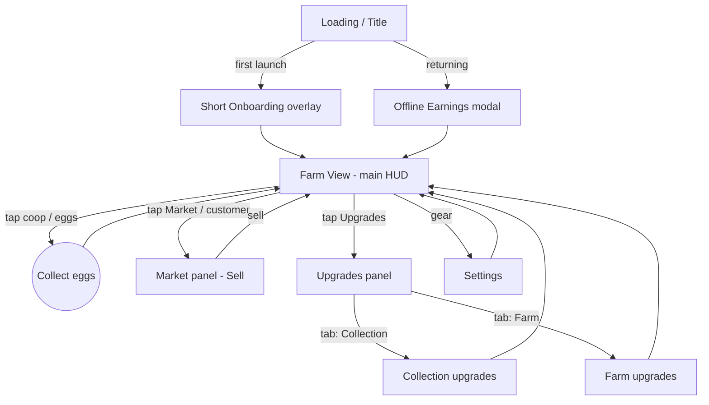

# Egg Farm Studio — Core Screen Flow, MVP Loop (M1 draft)
Owner: Head of Art & UX · 2026-10-15 · Scope: collect eggs → sell to customers → upgrade collection → upgrade farm. Workers are M2 (not shown). Economy numbers owned by Product.

## Flow diagram

## Persistent HUD (Farm View, all panels overlay it)
- Top bar: Egg counter (+ rate/sec), Coin counter (+ rate/sec), Settings gear.
- Bottom bar (portrait 360×640 primary) / side rail (desktop landscape): Market, Upgrades buttons; badge dot when something is affordable/actionable.
- Feedback: counters pulse on change; floating "+N"; badges animate once when newly affordable.

## Screens
### 1. Loading / Title
- Purpose: load assets, restore save. Elements: logo, progress bar, "Tap to start" (web audio unlock).
- States: loading, error (retry), ready.

### 2. Onboarding overlay (first session only)
- Purpose: teach loop in 3 steps: tap to collect → sell to customer → buy first upgrade.
- Elements: pointing hand, dimmed background with spotlight, short caption. Action: perform highlighted step; Skip.
- States: step 1/2/3, completed (never shown again).

### 3. Farm View (home)
- Purpose: core idle screen; see chickens produce eggs.
- Elements: coop(s), chickens, egg pile/nest showing accumulated eggs, customer queue at stall, HUD.
- Actions: tap nest/coop to collect eggs; tap customer to open Market/sell; open Upgrades.
- States: eggs accumulating (pile grows), nest full (capacity cap → glow + "Full!" tag), customers waiting, no customers.

### 4. Market panel (Sell)
- Purpose: convert eggs to coins via customers.
- Elements: customer cards (avatar, wants N eggs, pays X coins), "Sell" button per customer, "Sell all" option (TBD by Product), egg stock.
- Actions: sell to customer, close.
- States: enough eggs (button active), not enough eggs (disabled + shortfall shown), no customers (next arrival timer), sold (coin burst, card leaves, next slides in).

### 5. Upgrades panel (tabs: Collection / Farm)
- Purpose: spend coins to grow.
- Collection tab: e.g. collect amount per tap, nest capacity, auto-collect speed (list per Product spec).
- Farm tab: e.g. more chickens, coop level, egg value, customer rate.
- Row elements: icon, name, level, current → next effect, cost button.
- States: affordable (green glow), unaffordable (dimmed, cost in red-muted), locked (lock icon + unlock condition), maxed ("MAX"), purchased (sparkle + level bump; Farm upgrades also visibly change the farm view).

### 6. Offline Earnings modal
- Purpose: reward return (AC11). Elements: time away (cap 2h), eggs earned, "Collect" (to Basket, bypasses coop cap); closing without Collect still grants the eggs. States: skipped if away < 60 s; shown once per absence. IN for M1 (Product confirmed).

### 7. Settings
- SFX toggle (music is out of M1), reduced motion, reset save (confirm dialog), credits.

## Feedback summary
| Action | Visual | Audio | HUD |
|---|---|---|---|
| Collect | eggs pop & fly to counter, "+N" | soft pop | egg counter pulse |
| Sell | coins arc to counter, customer happy emote | cha-ching | coin counter pulse, egg counter decrements |
| Upgrade | sparkle burst, row level bump, farm change | level-up chime | coin counter decrements; badges refresh |
| Can't afford | button shake | dull bonk | shortfall shown |

## Open questions
Product:
1. Is collecting manual tap, auto, or both in M1? Is there a nest capacity cap?
2. Do customers request specific quantities, or is selling a single "sell eggs at price" action? Sell all?
3. Final upgrade list per tab, and do Farm upgrades change visuals (coop levels)?
4. Offline earnings in M1? Onboarding in M1?
5. Single farm/coop or multiple plots in M1?
Engineering (answered 2026-10-15, see engineering/stack-and-architecture.md):
1. ~~Rendering stack~~ Resolved: plain DOM/CSS; particles as CSS/DOM, ≤30 on screen.
2. ~~Orientation~~ Resolved: responsive, portrait-phone first (360×640 min) up to desktop landscape.
3. ~~Asset pipeline~~ Resolved: SVG per asset (kebab-case, viewBox, no raster); PNG @2x only for painted art, no atlas; self-hosted woff2 fonts, font-display swap.
4. ~~Save system~~ Resolved (Engineering + Product agreed): localStorage versioned JSON; autosave every 5s, on every upgrade, and on visibilitychange/pagehide. Offline progress capped at 2h at 50% rate (under 60s grants nothing), feeds the Offline Earnings modal.

Product (answered 2026-10-15, see product/core-loop-spec.md): manual tap only + coop cap (50+50×Farm L, "Full!"); customers want N eggs, per-card "Sell k/N" + "Sell all"; Collection = 1 row, Farm = 1 row, L30 = MAX; coop tier art at Farm L5/10/20, hens shown = min(hens,12); offline welcome-back modal YES (AC11, CEO decision); onboarding YES; single coop.

5. ~~Audio~~ Resolved (Engineering 2026-10-15): audio unlocks on the first "Tap to start" tap; sfx are mp3 only, <50 KB each, 44.1 kHz mono, in art-ux/assets/audio/, kebab-case. Product confirms: SFX are IN for M1 (Art & UX owns); music is out.

### SFX — SOURCED 2026-10-15 (art-ux/assets/audio/, procedural CC0, see LICENSES.md)
| File | Trigger |
|---|---|
| sfx-tap-start.mp3 | Tap to start (audio unlock) |
| sfx-collect-pop.mp3 | Collect tap |
| sfx-coop-full.mp3 | Coop reaches cap |
| sfx-sell-coin.mp3 | Sale completed |
| sfx-customer-arrive.mp3 | Customer joins queue |
| sfx-customer-leave.mp3 | Customer leaves unserved |
| sfx-upgrade.mp3 | Upgrade bought |
| sfx-cant-afford.mp3 | Disabled button tapped |
| sfx-ui-open.mp3, sfx-ui-close.mp3 | Panel open/close |
| sfx-welcome-back.mp3 | Offline modal shown |
